# 02 — Database Design and ERD

| Field | Value |
|---|---|
| Status | Approved baseline (Phase 0), 2026-10-31. Codex schema review pending (TASK-0001). |
| Owner | Claude Code; Codex reviews indexes, integrity, and rollback |
| Engine | MySQL 8.4 LTS, InnoDB, `utf8mb4` / `utf8mb4_0900_ai_ci` |
| ADRs | 0002 (single org), 0004 (IDs and time), 0006 (append-only audit), 0007 (evidence), 0010 (confidence) |

## 1. Conventions

| Topic | Rule |
|---|---|
| Primary keys | `id BIGINT UNSIGNED AUTO_INCREMENT`. Internal only. |
| Public IDs | `ulid CHAR(26) UNIQUE` on every entity addressed through a URL or API. Routes bind by ULID. |
| Time | `DATETIME(6)` in UTC. Laravel `created_at`/`updated_at` use the same type. Never `TIMESTAMP` (2038 limit). |
| Time semantics | `published_at` = the source published it; `observed_at` = the fact held in the world; `collected_at`/`captured_at` = we obtained it; `verified_at` = review decision; `released_at` = made visible internally. Never merged. |
| Enums | `VARCHAR(n)` + `CHECK (col IN (…))`, mapped to PHP backed enums. Adding a value needs a migration. |
| Classification | `classification VARCHAR(12) NOT NULL DEFAULT 'internal' CHECK IN ('public','internal','confidential','restricted')`. |
| Foreign keys | Always declared. `ON DELETE RESTRICT` for evidence and provenance; `CASCADE` only for pure child rows (aliases, pivots). |
| Polymorphism | Not used for integrity-critical links (explicit pivots instead). Allowed only for `taggables` and audit subject references. |
| Deletion | No soft deletes on evidence or intelligence. Lifecycle runs through status, retraction, and supersession. Registry rows are archived, not deleted. |
| Append-only | Enforced by MySQL grants: the `app` user has `SELECT, INSERT` only on these tables. Migrations run as a separate `migrator` user. |
| Money | `DECIMAL(19,4)` + `currency CHAR(3)`. Never floats. |
| JSON | Only for extensible attributes and redacted context. Never for fields that are filtered or joined on. |
| Naming | Laravel conventions: plural snake_case tables, `<singular>_id` FKs, alphabetical pivot names. |

## 2. Phase 1 ERD

```mermaid
erDiagram
  users ||--o{ team_user : member
  teams ||--o{ team_user : has
  users ||--o{ access_grants : grantee
  teams ||--o{ access_grants : grantee
  users ||--o{ user_invitations : invited_by
  users ||--o{ competitors : assigned_analyst
  competitors ||--o{ competitor_aliases : has
  competitors ||--o{ competitor_relationships : parent
  competitors ||--o{ competitor_relationships : child
  competitors ||--o{ brands : owns
  competitors ||--o{ products : sells
  brands ||--o{ products : brands
  product_categories ||--o{ product_categories : parent
  product_categories ||--o{ products : classifies
  products ||--o{ product_variants : has
  markets ||--o{ regions : has
  regions ||--o{ regions : parent
  channels ||--o{ retailers : type
  markets ||--o{ retailers : operates_in
  sources ||--o{ source_policies : versions
  evidence_blobs ||--o{ evidence_assets : content
  sources ||--o{ evidence_assets : from
  source_policies ||--o{ evidence_assets : authorized_by
  evidence_assets ||--o{ evidence_asset_competitor : scoped
  competitors ||--o{ evidence_asset_competitor : scope
  evidence_assets ||--o{ evidence_asset_market : scoped
  markets ||--o{ evidence_asset_market : scope
  competitors ||--o{ access_grants : scope
  markets ||--o{ access_grants : scope
  audit_events ||--o| audit_event_network : personal_data
  evidence_assets ||--o{ evidence_custody_events : custody
  intelligence_items ||--o{ intelligence_claims : contains
  intelligence_claims ||--o{ claim_evidence_links : cites
  evidence_assets ||--o{ claim_evidence_links : cited_by
  intelligence_items ||--o{ competitor_intelligence_item : about
  competitors ||--o{ competitor_intelligence_item : subject
  intelligence_items ||--o{ intelligence_item_product : about
  products ||--o{ intelligence_item_product : subject
  intelligence_items ||--o{ intelligence_item_market : about
  markets ||--o{ intelligence_item_market : subject
  intelligence_items ||--o{ verification_reviews : reviewed
  intelligence_items ||--o| retractions : retracted
  intelligence_items ||--o| intelligence_items : supersedes
  users ||--o{ audit_events : actor
```

## 3. Phase 1 table specifications

### 3.1 Platform

**audit_events** (append-only)
| Column | Type | Notes |
|---|---|---|
| id | BIGINT UNSIGNED PK | |
| ulid | CHAR(26) UNIQUE | |
| occurred_at | DATETIME(6) | |
| actor_type | VARCHAR(16) CHECK (user, service, system) | |
| actor_id | BIGINT UNSIGNED NULL | FK users (nullable for system); `ON DELETE RESTRICT` |
| action | VARCHAR(100) | dotted verb, e.g. `evidence.downloaded`, `auth.login_failed` |
| subject_type | VARCHAR(100) NULL | morph alias |
| subject_id | BIGINT UNSIGNED NULL | |
| subject_ulid | CHAR(26) NULL | stable external reference |
| classification | VARCHAR(12) | of the subject at event time |
| request_id | CHAR(26) NULL | correlates with logs |
| context | JSON NULL | allowlisted keys only; secrets and prompts redacted |
| row_hash | CHAR(64) | SHA-256 of the canonical serialization of **all columns above** (immutable fields only) |

Indexes: (subject_type, subject_id, occurred_at), (actor_id, occurred_at), (action, occurred_at), (occurred_at).

**audit_event_network** (personal data, kept apart so `audit_events` never changes; TASK-0001 #8): audit_event_id PK/FK → audit_events, ip_address VARCHAR(45), user_agent_hash CHAR(64) NULL, created_at. **Not** covered by `row_hash` or checkpoints. The retention job **deletes** rows after the retention period. This is the only deletion allowed, and it never touches a hashed row.

**audit_checkpoints** (append-only): id, generation INT, from_audit_id, to_audit_id, event_count, merkle_root CHAR(64), watermark_at DATETIME(6), signing_key_id VARCHAR(64), signature VARBINARY(64) (Ed25519 over the manifest), manifest_object_key VARCHAR(512), created_at. UNIQUE(to_audit_id). Checkpoint rules (ADR-0006):
- A range closes only for rows whose `occurred_at` is older than the **lag window** (default 15 min; the maximum business-transaction duration is capped below it and monitored).
- The manifest (range, count, root, key ID, signature) is exported to the **audit-anchor** bucket (separate credentials, object lock in compliance mode; replicated offsite in production).
- Verification compares the database against the **signed exported manifest**, not against the checkpoint row alone.
- A row that commits late inside a closed range causes a count mismatch. Verification reports it as `late_commit` (high, investigated by runbook). It is re-anchored in a supplementary checkpoint of the same generation and never silently absorbed.

**outbox_events**: id, ulid UNIQUE, aggregate_type VARCHAR(100), aggregate_id BIGINT UNSIGNED, event_type VARCHAR(100), payload JSON (IDs and minimal data, no classified content), available_at, dispatched_at NULL, attempts SMALLINT UNSIGNED, last_error TEXT NULL, created_at. Index: (dispatched_at, available_at).

**features** (Laravel Pennant), **jobs/failed_jobs/job_batches**, **cache**, and **sessions** use framework defaults.

### 3.2 Identity

**users**: id, ulid, name, email UNIQUE, email_verified_at, password, clearance VARCHAR(12) CHECK, status VARCHAR(16) CHECK (invited, active, suspended, deactivated), two_factor_secret TEXT NULL (encrypted), two_factor_recovery_codes TEXT NULL (encrypted), two_factor_confirmed_at, mfa_required BOOL, timezone VARCHAR(64) DEFAULT 'UTC', locale VARCHAR(10), last_login_at, remember_token, timestamps. Index: (status).

**roles, permissions, model_has_roles, model_has_permissions, role_has_permissions**: spatie/laravel-permission defaults with guards `web` and `sanctum`.

**teams**: id, ulid, name UNIQUE, description, lead_user_id FK NULL, timestamps.
**team_user**: team_id FK CASCADE, user_id FK CASCADE, added_by FK, created_at. PK (team_id, user_id).

**access_grants**
| Column | Type | Notes |
|---|---|---|
| id, ulid | | |
| user_id | FK NULL | exactly one of user_id/team_id: `CHECK ((user_id IS NULL) <> (team_id IS NULL))` |
| team_id | FK NULL | |
| scope_type | VARCHAR(16) CHECK (all, competitor, market) | |
| competitor_id | FK competitors NULL, `ON DELETE RESTRICT` | typed scope target (TASK-0001 #2) |
| market_id | FK markets NULL, `ON DELETE RESTRICT` | typed scope target |
| | | `CHECK ((scope_type='all' AND competitor_id IS NULL AND market_id IS NULL) OR (scope_type='competitor' AND competitor_id IS NOT NULL AND market_id IS NULL) OR (scope_type='market' AND market_id IS NOT NULL AND competitor_id IS NULL))` |
| max_classification | VARCHAR(12) CHECK | cap on what this grant opens |
| can_export | BOOL DEFAULT 0 | |
| granted_by | FK users | |
| reason | VARCHAR(500) | |
| expires_at | DATETIME(6) NULL | |
| revoked_at, revoked_by | NULL | revocation, never deletion |
| timestamps | | |

Indexes: (user_id, revoked_at), (team_id, revoked_at), (competitor_id), (market_id).
Archiving a competitor or market does not delete it, so grants stay referentially valid. An archived target's grants keep working for historical records.

**user_invitations**: id, ulid, email, role_name, clearance, token_hash CHAR(64) UNIQUE, invited_by FK, expires_at, accepted_at NULL, revoked_at NULL, timestamps. Index: (email).

**personal_access_tokens**: Sanctum default. Abilities are required and expiry is enforced.

### 3.3 Registry

**competitors**: id, ulid, name, legal_name NULL, slug UNIQUE, website VARCHAR(2048) NULL, hq_country CHAR(2) NULL, lifecycle VARCHAR(16) CHECK (active, watch, dormant, archived), tier VARCHAR(16) NULL CHECK (primary, secondary, emerging), assigned_analyst_id FK NULL, classification, description TEXT NULL, created_by FK, timestamps. Indexes: (lifecycle), (assigned_analyst_id), FULLTEXT(name, legal_name) as a Phase 1 search fallback.

**competitor_aliases**: id, competitor_id FK CASCADE, alias VARCHAR(255), alias_type CHECK (brand, trade, former, abbreviation, local), timestamps. UNIQUE(competitor_id, alias). Index: (alias).

**competitor_relationships**: id, parent_competitor_id FK, child_competitor_id FK, relation_type CHECK (subsidiary, brand_owner, joint_venture, partner, distributor), valid_from DATE **NOT NULL** (use the earliest known date; `valid_from_precision` CHECK (day, month, year, unknown) records uncertainty), valid_to DATE NULL (open-ended), notes, created_by, timestamps. `CHECK (parent_competitor_id <> child_competitor_id)`, `CHECK (valid_to IS NULL OR valid_to >= valid_from)`. UNIQUE(parent, child, relation_type, valid_from).
**Non-overlap** (MySQL has no exclusion constraints): the create/update Action locks both competitor rows (`SELECT … FOR UPDATE`, ordered by id to avoid deadlock), then checks for overlap with `valid_from <= :to AND COALESCE(valid_to,'9999-12-31') >= :from`, then inserts, all in one transaction. Concurrency tests are required (TASK-0001 #6).

**NULL-safe uniqueness pattern** (TASK-0001 #6): where a nullable FK takes part in business uniqueness, add a stored generated column `<fk>_key BIGINT UNSIGNED AS (COALESCE(<fk>, 0)) STORED` and put the UNIQUE index on it. The real FK column keeps its foreign key.

**brands**: id, ulid, competitor_id FK NULL (NULL = our own brand), competitor_key (generated), name, timestamps. UNIQUE(competitor_key, name).

**product_categories**: id, parent_id FK NULL, parent_key (generated), name, path VARCHAR(1000) (materialized, e.g. `/12/45/`), depth TINYINT, timestamps. Indexes: UNIQUE(parent_key, name), (path).

**products**: id, ulid, owner_kind CHECK (competitor, own), competitor_id FK NULL, brand_id FK NULL, category_id FK NULL, name, description TEXT NULL, status CHECK (active, discontinued, rumored), launched_on DATE NULL, discontinued_on DATE NULL, classification, created_by, timestamps.
`CHECK ((owner_kind = 'competitor' AND competitor_id IS NOT NULL) OR (owner_kind = 'own' AND competitor_id IS NULL))`. Indexes: (competitor_id, status), (category_id).

**product_variants**: id, ulid, product_id FK CASCADE, sku VARCHAR(100), gtin VARCHAR(14) NULL, name, pack_size DECIMAL(14,4), pack_unit CHECK (mg, g, kg, ml, l, unit, pack), pack_count SMALLINT DEFAULT 1, attributes JSON NULL, status, timestamps. UNIQUE(product_id, sku); index (gtin).

**markets**: id, ulid, code VARCHAR(20) UNIQUE, name, country CHAR(2), default_currency CHAR(3) FK currencies, timestamps.
**regions**: id, market_id FK, parent_id FK NULL, parent_key (generated), name, level CHECK (region, province, city, district), timestamps. UNIQUE(market_id, parent_key, name).
**channels**: id, name UNIQUE, channel_type CHECK (modern_trade, general_trade, ecommerce, horeca, wholesale, direct, other).
**retailers**: id, ulid, name, channel_id FK, market_id FK, website NULL, timestamps. UNIQUE(market_id, name).
**currencies**: code CHAR(3) PK, name, minor_units TINYINT. Seeded with an ISO 4217 subset.
**tags**: id, name, taxonomy VARCHAR(50). UNIQUE(taxonomy, name). **taggables**: tag_id, taggable_type, taggable_id. PK on all three columns.

### 3.4 Sources

**sources**: id, ulid, name, source_type CHECK (website, rss, api, licensed_feed, public_filing, social, internal, field, other), base_url VARCHAR(2048) NULL, host VARCHAR(255) NULL (normalized lowercase, punycode), method CHECK (manual, rss, api, http_fetch, browser) DEFAULT manual, status CHECK (proposed, policy_review, approved, suspended, retired), default_reliability CHAR(1) CHECK (A–F), current_policy_id FK NULL, owner_id FK users, classification, description, timestamps. Indexes: (host), (status).
Phase 1 rule: application validation rejects `method <> 'manual'` while the `collection` feature flag is off.

**source_policies** (append-only versions): id, source_id FK, version SMALLINT, terms_url NULL, terms_summary TEXT, terms_reviewed_at, robots_decision CHECK (allowed, disallowed, not_applicable, not_reviewed), license VARCHAR(255) NULL, allowed_cadence VARCHAR(50) NULL, rate_budget_per_hour INT NULL, retention_days INT NULL, contains_personal_data BOOL, decision CHECK (approved, rejected, needs_info), decided_by FK, decided_at, notes TEXT, created_at. UNIQUE(source_id, version).

### 3.5 Evidence

**evidence_blobs** (holds **only content that scanned clean**; a blob row never exists for infected or unscanned bytes, TASK-0001 #7): id, sha256 CHAR(64) UNIQUE, storage_disk VARCHAR(32), storage_key VARCHAR(512) UNIQUE, object_version_id VARCHAR(128), size_bytes BIGINT UNSIGNED, detected_mime VARCHAR(127), first_scan_engine VARCHAR(100), first_scanned_at, retention_until DATE NULL (= MAX over referencing assets), legal_hold BOOL (= OR over referencing assets), integrity_status CHECK (ok, mismatch) DEFAULT ok, last_verified_at NULL, created_at.
Creation is `INSERT … ON DUPLICATE KEY UPDATE id = LAST_INSERT_ID(id)` followed by a reload. The object is copied **before** the insert under its content-addressed key, so a duplicate copy writes identical bytes and is harmless. Retention and hold aggregates are recomputed under `SELECT … FOR UPDATE` on the blob row whenever any referencing asset changes, then pushed to the MinIO object version.

**evidence_assets**: id, ulid, evidence_blob_id FK NULL (NULL until scanned clean) `ON DELETE RESTRICT`, quarantine_key VARCHAR(512) NULL, scan_status CHECK (pending, clean, infected, error), scan_engine NULL, scanned_at NULL, source_id FK NULL, **source_policy_id FK source_policies NULL** (the policy version in force at capture; required when `source_id` is set, TASK-0001 #5), source_url VARCHAR(2048) NULL, original_filename VARCHAR(255) (sanitized), title, description TEXT NULL, captured_at, published_at NULL, uploaded_by FK, classification, status CHECK (quarantined, available, rejected, withdrawn), retention_until DATE NULL, legal_hold BOOL, timestamps. `CHECK (source_id IS NULL OR source_policy_id IS NOT NULL)`. Indexes: (status, captured_at), (source_id), (uploaded_by).
Scan results are **monotonic**: pending → clean | infected | error; error → pending (retry); a terminal result is never overwritten except by an explicit, audited re-quarantine action.
**Linkable** = `status = available`. **Readable** (by authorized users) = `available`, plus `withdrawn` for provenance display (metadata always; content only while retention allows). Legal hold is a flag, not a status (TASK-0001 #10).

**evidence_asset_competitor**, **evidence_asset_market** (scope pivots, TASK-0001 #1): composite PKs, FK CASCADE on the asset side, RESTRICT on the subject side, `origin` CHECK (declared, inherited) + added_by + created_at. Scopes are **declared** at upload and **inherited** automatically when the asset is linked to a claim. Inheritance takes the item's competitors and markets, is monotonic, and is never removed by unlinking without an audited admin action.

**evidence_custody_events** (append-only): id, evidence_asset_id FK, event CHECK (uploaded, scanned, rejected, viewed, downloaded, linked, unlinked, scope_inherited, hold_set, hold_released, retention_changed, integrity_verified, integrity_failed, withdrawn), actor_type, actor_id FK NULL, occurred_at, details JSON NULL. Index: (evidence_asset_id, occurred_at).

### 3.6 Intelligence

**intelligence_items**: id, ulid, title, summary TEXT (sanitized Markdown), item_type CHECK (news, product_change, pricing_signal, strategy, leadership, partnership, regulatory, facility, financial, other), classification, high_impact BOOL, status CHECK (draft, submitted, in_review, changes_requested, approved, published, rejected, retracted, superseded), author_id FK, owner_id FK, assigned_reviewer_id FK NULL, observed_at NULL, published_at NULL, collected_at NULL, verified_at NULL, released_at NULL, version SMALLINT UNSIGNED DEFAULT 1, supersedes_id FK self NULL, timestamps. Indexes: (status, updated_at), (author_id), (assigned_reviewer_id, status), (released_at).

**competitor_intelligence_item, intelligence_item_product, intelligence_item_market**: composite PKs, FK CASCADE on the item side and RESTRICT on the subject side.

**intelligence_claims**: id, ulid, intelligence_item_id FK CASCADE, position SMALLINT, statement TEXT, claim_type CHECK (observed_fact, reported_claim, analyst_inference, rumor, ai_hypothesis), source_reliability CHAR(1) CHECK (A–F), info_credibility TINYINT CHECK (1–6), status CHECK (active, disputed, withdrawn), created_by, timestamps. Index: (intelligence_item_id, position).

**claim_evidence_links**: id, intelligence_claim_id FK CASCADE, evidence_asset_id FK RESTRICT, relation CHECK (supports, contradicts, context), locator VARCHAR(255) NULL (page, section, or timecode), excerpt TEXT NULL, linked_by FK, created_at. UNIQUE(intelligence_claim_id, evidence_asset_id, relation).

**verification_reviews** (append-only): id, ulid, intelligence_item_id FK, item_version SMALLINT, reviewer_id FK, decision CHECK (approve, reject, request_changes, publish, reassign, flag_for_rereview), rationale TEXT, content_hash CHAR(64) (hash of the item's title, summary, claims, and links at that version), decided_at. Index: (intelligence_item_id, item_version, decision).
**Publish invariant** (TASK-0001 #3, #4): inside one transaction with `SELECT … FOR UPDATE` on the item, publishing requires status = approved, and an `approve` review whose `item_version` equals the current `version` and whose `content_hash` matches the recomputed hash. The approver must be distinct from the author, and the publisher distinct from both. Item content is editable only in `draft` and `changes_requested`; any edit increments `version`.

**retractions**: id, intelligence_item_id FK UNIQUE, reason TEXT, retracted_by FK, retracted_at, replacement_item_id FK NULL.

## 4. Later-phase tables (designed, not yet migrated)

| Phase | Table | Key design points |
|---|---|---|
| 2 | `price_observations` | **append-only**; variant_id, competitor_id, retailer_id, market_id, region_id, channel_id, amount DECIMAL(19,4), currency, price_type (shelf, promo, online, wholesale), pack_size, pack_unit, unit_price_normalized DECIMAL(19,6), normalized_unit, normalization_version, exchange_rate_snapshot_id, observed_at, collected_at, evidence_asset_id, source_id, field_submission_id, submitted_by, status (pending_review, accepted, rejected), fingerprint CHAR(64) UNIQUE, supersedes_id. Reviews are held in `price_observation_reviews` (append-only), never as an UPDATE. Indexes: (variant_id, observed_at), (competitor_id, observed_at), (market_id, channel_id, observed_at). **No partitioning** (MySQL partitioned tables cannot have FKs); revisit at measured volume. |
| 2 | `promotion_observations` | mechanic (discount_pct, bundle, bogo…), valid_from/to, same provenance columns as prices |
| 2 | `unit_conversions`, `exchange_rate_snapshots` | versioned; rates carry source and as_of |
| 2 | `product_matches` | own_variant_id ↔ competitor_variant_id, match_type, confidence by analyst, approved_by |
| 2 | `field_submissions` | submitter, kind, payload JSON (validated), location (opt-in), status, review |
| 2 | `alert_rules` (versioned), `alerts` | alerts: dedupe_key UNIQUE, rule_id, rule_version, severity, rationale, status, owner_id, evidence links |
| 2 | `investigations`, `tasks`, `battlecards`, `battlecard_versions`, `reports`, `report_runs`, `saved_views`, `subscriptions`, `notification_deliveries` | versions are immutable; exports are audited |
| 3 | `collection_schedules`, `collection_runs`, `source_snapshots`, `raw_ingestion_items`, `ingestion_errors`, `extracted_documents`, `document_chunks` | snapshots: sha256, storage_key, http_status, etag, last_modified, fetched_at; raw items: fingerprint UNIQUE; chunks carry a copy of the ACL |
| 4 | `ai_conversations`, `ai_messages`, `ai_tool_calls`, `ai_citations`, `ai_model_usage`, `ai_prompt_versions`, `ai_eval_cases`, `ai_evaluations`, `pending_actions`, `ai_endpoints` | pending_actions (TASK-0001 #12): user_id FK, session_id_hash, conversation_id / voice_session_id, token_hash, tool, normalized args JSON, args_hash, expires_at, confirmed_at, consumed_at (set atomically by `UPDATE … WHERE consumed_at IS NULL`), outcome. ai_endpoints (TASK-0001 #11): approved local endpoints with host, resolved network class, approved_by |
| 5 | `voice_sessions`, `transcript_segments` | no raw audio by default; retention_until |
| 6 | `integrations`, `webhook_events` (idempotency_key UNIQUE), `data_retention_jobs`, `legal_holds` | |

## 5. Query paths and indexes (Phase 1)

| Query | Index |
|---|---|
| Verification queue for a reviewer | intelligence_items(assigned_reviewer_id, status) |
| Recently published feed | intelligence_items(released_at) + visibility join |
| Competitor detail → items | competitor_intelligence_item(competitor_id, intelligence_item_id) |
| Evidence awaiting scan | evidence_assets(status, captured_at) |
| Audit trail for a record | audit_events(subject_type, subject_id, occurred_at) |
| User's effective grants | access_grants(user_id, revoked_at) + team_user |

Each Phase 1 list query is checked with `EXPLAIN` against seeded volume (10k items, 100k audit events) before merge.

## 6. Database users and grants

| User | Privileges |
|---|---|
| `cais_migrator` | DDL on schema (no views); used only by migrations and `db:apply-grants` in the `migrator` service |
| `cais_app` | SELECT, INSERT, UPDATE, DELETE on mutable tables; **SELECT, INSERT only** on `audit_events`, `audit_event_network`, `audit_checkpoints`, `evidence_custody_events`, `source_policies`, `verification_reviews` (and later `price_observations` and others) |
| `cais_readonly` | SELECT for backups and reporting |
| `cais_retention` | SELECT, DELETE on `audit_event_network` only; used only by the scheduled retention job (§8). **No** UPDATE or DELETE on any hashed audit table. |

A migration-adjacent artisan command `db:apply-grants` keeps the grants in code. A test asserts that UPDATE and DELETE fail as `cais_app`.

**Implementation (P1-09, 2026-10-31):**
- Accounts and schema-level privileges: `docker/mysql/init/10-accounts.sh` (idempotent; runs at first volume init and from `scripts/dev/setup.sh`). Each account's global and schema privileges are reset and set exactly. `cais_migrator` holds its schema privileges `WITH GRANT OPTION` so that `db:apply-grants` can manage table grants without root. `cais_app` and `cais_retention` have **no** schema-level privileges. `cais_readonly` has `SELECT, SHOW VIEW` on the main schema only. The script also removes every table grant of the managed accounts and then requires each `SHOW GRANTS` line to be exactly an expected one (TASK-0005 #1); app and retention table access returns with the next migrate.
- Table grants: policy in `config/database.php` → `grants` (append-only list, tables without app access such as `migrations`, retention tables). `Modules\Platform\Database\TableGrants` grants the target privileges and `REVOKE IF EXISTS` the rest per table, so a needed privilege is never briefly missing. It runs after every migration (also when nothing was pending) and on demand with `php artisan db:apply-grants -v`. Grants left on dropped tables are revoked too. Afterwards it reads each account's own `SHOW GRANTS` and fails unless they equal the policy table by table.
- Migration commands (`migrate*`, `schema:dump`) switch to the migrator connection automatically unless `--database` is given; as the app account they fail closed.
- `cais_test` is created alongside the main schema for automated tests; the migrator has the same rights there.
- Tests: `modules/Platform/tests/Feature/DatabaseAccountsTest.php` (MySQL 8.4, real accounts) proves the mechanism on probe tables and compares the app account's actual grants on every real table with the policy.
- Rollback: revert the commit; then, only with explicit authorization, `DROP USER cais_app, cais_retention, cais_readonly` as root and point `DB_USERNAME` back at the migrator. Data is not affected.

**Hardening after Codex review TASK-0003 (2026-10-31; `handoffs/TASK-0003-review.md`):**
- The migrator's credentials exist only in `.secrets/migrator.env`, given to the one-shot `migrator` compose service and to MySQL's account init; `.secrets/` is hidden inside every container that mounts the repository (TASK-0004). Web, Horizon and scheduler containers do not have them; the `migrator` connection is not even configured there, and schema commands fail with instructions. CI asserts this. A source scan allows the name `migrator` only in the Platform migration wiring.
- Every table must be classified in `config/database.php` → `grants` as `mutable`, `append_only` or `app_excluded`. An unclassified table gets no app access and fails the grant run, and with it the migration. Views are not permitted: the migrator no longer holds `CREATE VIEW`, and any view fails the grant run.
- The account init script also revokes granted roles, proxy privileges, schema privileges on any database, column grants, and table grants left on objects that no longer exist. It then requires every line of each managed account's `SHOW GRANTS` to be on an exact allowlist, which also catches dynamic global privileges. CI seeds such privileges and expects them gone (`scripts/ci/accounts-test.sh`).
- A data-driven test checks every configured append-only table once it exists: `SELECT, INSERT` granted; `UPDATE`, `DELETE` and `TRUNCATE` denied.

## 7. Migration discipline

- Every migration has a working `down()`, or a documented and tested recovery procedure.
- CI runs migrate → rollback → migrate on an ephemeral MySQL 8.4.
- Expand/contract for zero downtime: add nullable → backfill job → enforce → remove old column in a later release.
- Take a backup before any destructive alteration. Never run `migrate:fresh` or `db:wipe` outside an ephemeral database without explicit authorization.

## 8. Retention

| Data | Default | Notes |
|---|---|---|
| Evidence | per source policy `retention_days`; legal hold overrides | object lock prevents early deletion |
| Audit events | 7 years (proposal, O5) | archived, never mutated |
| IP addresses / user-agent hashes (`audit_event_network`) | 1 year, then deleted by the retention job | the row lives outside the hashed audit record, so checkpoints stay valid |
| Transcripts [P5] | 30 days (O8) | |

## Assumptions
- Data volume is modest in Phase 1–2 (≤1M price observations/year). Revisit partitioning and read replicas with metrics.

## Risks
- `UNIQUE` NULL semantics (MySQL treats NULLs as distinct). Mitigation: the generated-key pattern (§3.3) plus concurrency tests.
- Temporal non-overlap is enforced by locking in an Action, not by the database. Mitigation: a single Action owns all writes, and concurrency tests cover it.
- Late-committing audit rows inside a closed checkpoint range. Mitigation: lag window, transaction-duration cap and monitoring, `late_commit` handling (§3.1).

## Acceptance criteria
- Codex schema review recorded (TASK-0001), or its absence stated explicitly.
- Each Phase 1 migration matches this document; deviations are recorded here before merge.
