# 02 — Database Design and ERD

| Field | Value |
|---|---|
| Status | Approved baseline (Phase 0), 2026-10-31. Codex schema review pending (TASK-0001). |
| Owner | Claude Code; Codex reviews indexes, integrity, and rollback |
| Engine | MySQL 8.4 LTS, InnoDB, `utf8mb4` / `utf8mb4_0900_ai_ci` |
| ADRs | 0002 (single org), 0004 (IDs and time), 0006 (append-only audit), 0007 (evidence), 0010 (confidence) |

## 1. Conventions

| Topic | Rule |
|---|---|
| Primary keys | `id BIGINT UNSIGNED AUTO_INCREMENT`. Internal only. |
| Public IDs | `ulid CHAR(26) UNIQUE` on every entity addressed through a URL or API. Routes bind by ULID. |
| Time | `DATETIME(6)` in UTC. Laravel `created_at`/`updated_at` use the same type. Never `TIMESTAMP` (2038 limit). |
| Time semantics | `published_at` = the source published it; `observed_at` = the fact held in the world; `collected_at`/`captured_at` = we obtained it; `verified_at` = review decision; `released_at` = made visible internally. Never merged. |
| Enums | `VARCHAR(n)` + `CHECK (col IN (…))`, mapped to PHP backed enums. Adding a value needs a migration. |
| Classification | `classification VARCHAR(12) NOT NULL DEFAULT 'internal' CHECK IN ('public','internal','confidential','restricted')`. |
| Foreign keys | Always declared. `ON DELETE RESTRICT` for evidence and provenance; `CASCADE` only for pure child rows (aliases, pivots). |
| Polymorphism | Not used for integrity-critical links (explicit pivots instead). Allowed only for `taggables` and audit subject references. |
| Deletion | No soft deletes on evidence or intelligence. Lifecycle runs through status, retraction, and supersession. Registry rows are archived, not deleted. |
| Append-only | Enforced by MySQL grants: the `app` user has `SELECT, INSERT` only on these tables. Migrations run as a separate `migrator` user. |
| Money | `DECIMAL(19,4)` + `currency CHAR(3)`. Never floats. |
| JSON | Only for extensible attributes and redacted context. Never for fields that are filtered or joined on. |
| Naming | Laravel conventions: plural snake_case tables, `<singular>_id` FKs, alphabetical pivot names. |

## 2. Phase 1 ERD

```mermaid
erDiagram
  users ||--o{ team_user : member
  teams ||--o{ team_user : has
  users ||--o{ access_grants : grantee
  teams ||--o{ access_grants : grantee
  users ||--o{ user_invitations : invited_by
  users ||--o{ competitors : assigned_analyst
  competitors ||--o{ competitor_aliases : has
  competitors ||--o{ competitor_relationships : parent
  competitors ||--o{ competitor_relationships : child
  competitors ||--o{ brands : owns
  competitors ||--o{ products : sells
  brands ||--o{ products : brands
  product_categories ||--o{ product_categories : parent
  product_categories ||--o{ products : classifies
  products ||--o{ product_variants : has
  markets ||--o{ regions : has
  regions ||--o{ regions : parent
  channels ||--o{ retailers : type
  markets ||--o{ retailers : operates_in
  sources ||--o{ source_policies : versions
  evidence_blobs ||--o{ evidence_assets : content
  sources ||--o{ evidence_assets : from
  source_policies ||--o{ evidence_assets : authorized_by
  evidence_assets ||--o{ evidence_asset_competitor : scoped
  competitors ||--o{ evidence_asset_competitor : scope
  evidence_assets ||--o{ evidence_asset_market : scoped
  markets ||--o{ evidence_asset_market : scope
  competitors ||--o{ access_grants : scope
  markets ||--o{ access_grants : scope
  audit_events ||--o| audit_event_network : personal_data
  evidence_assets ||--o{ evidence_custody_events : custody
  intelligence_items ||--o{ intelligence_claims : contains
  intelligence_claims ||--o{ claim_evidence_links : cites
  evidence_assets ||--o{ claim_evidence_links : cited_by
  intelligence_items ||--o{ competitor_intelligence_item : about
  competitors ||--o{ competitor_intelligence_item : subject
  intelligence_items ||--o{ intelligence_item_product : about
  products ||--o{ intelligence_item_product : subject
  intelligence_items ||--o{ intelligence_item_market : about
  markets ||--o{ intelligence_item_market : subject
  intelligence_items ||--o{ verification_reviews : reviewed
  intelligence_items ||--o| retractions : retracted
  intelligence_items ||--o| intelligence_items : supersedes
  users ||--o{ audit_events : actor
```

## 3. Phase 1 table specifications

### 3.1 Platform

**audit_events** (append-only)
| Column | Type | Notes |
|---|---|---|
| id | BIGINT UNSIGNED PK | |
| ulid | CHAR(26) UNIQUE | |
| occurred_at | DATETIME(6) | |
| actor_type | VARCHAR(16) CHECK (user, service, system) | |
| actor_id | BIGINT UNSIGNED NULL | FK users (nullable for system); `ON DELETE RESTRICT` |
| action | VARCHAR(100) | dotted verb, e.g. `evidence.downloaded`, `auth.login_failed` |
| subject_type | VARCHAR(100) NULL | morph alias |
| subject_id | BIGINT UNSIGNED NULL | |
| subject_ulid | CHAR(26) NULL | stable external reference |
| classification | VARCHAR(12) | of the subject at event time |
| request_id | CHAR(26) NULL | correlates with logs |
| context | JSON NULL | allowlisted keys only; secrets and prompts redacted |
| row_hash | CHAR(64) | SHA-256 of the canonical serialization of **all columns above except `id`** (immutable fields only). `id` is assigned by MySQL at insert, so it is bound by the checkpoint's Merkle leaf instead (TASK-0010 #3). The hash is unkeyed: it detects accidental or naive edits; deliberate edits by someone with database write access are detected by checkpoints and, from P1-50, by the signed manifests |

Indexes: (subject_type, subject_id, occurred_at), (actor_id, occurred_at), (action, occurred_at), (occurred_at).

**audit_event_network** (personal data, kept apart so `audit_events` never changes; TASK-0001 #8): audit_event_id PK/FK → audit_events, ip_address VARCHAR(45), user_agent_hash CHAR(64) NULL, created_at. **Not** covered by `row_hash` or checkpoints. The retention job **deletes** rows after the retention period. This is the only deletion allowed, and it never touches a hashed row.

**audit_checkpoints** (append-only): id, generation INT, from_audit_id, to_audit_id, event_count, merkle_root CHAR(64), watermark_at DATETIME(6), signing_key_id VARCHAR(64), signature VARBINARY(64) (Ed25519 over the manifest), manifest_object_key VARCHAR(512), created_at. UNIQUE(to_audit_id). Checkpoint rules (ADR-0006):
- A range closes only for rows whose `occurred_at` is older than the **lag window** (default 15 min; the maximum business-transaction duration is capped below it and monitored).
- The manifest (range, count, root, key ID, signature) is exported to the **audit-anchor** bucket (separate credentials, object lock in compliance mode; replicated offsite in production).
- Verification compares the database against the **signed exported manifest**, not against the checkpoint row alone.
- A row that commits late inside a closed range causes a count mismatch. Verification reports it as `late_commit` (high, investigated by runbook). It is re-anchored in a supplementary checkpoint of the same generation and never silently absorbed.

**Implementation (P1-05, 2026-11-01):**
- Migration `modules/Platform/database/migrations/2026_11_01_100000_create_audit_tables.php`; CHECK constraints on actor type, user actor ID, classification, subject pairing, hash format and checkpoint range; `UNIQUE(generation, from_audit_id)` in addition to `UNIQUE(to_audit_id)`, so two concurrent checkpoint runs cannot close overlapping ranges. Signing columns (`signing_key_id`, `signature`, `manifest_object_key`) are added with P1-50.
- `Modules\Platform\Audit\AuditLogger::record(action, subject, context, actor, classification)` refuses to run unless a transaction is open on its connection (the default one, or the one named with `on()`). Actions and their **typed** context keys are registered with `AuditActions::define()` (`ulid`, `id`, `int`, `bool`, `code`, `sha256`, `text`, each optionally a list); secret-, token-, key- and prompt-like keys cannot be registered. `text` is limited to 500 characters and screened: values that look like credentials are refused. The screening is heuristic, so the guarantee is "typed and screened", not "no secret can ever be stored": callers record IDs, codes and digests, never user input, prompts or document content (TASK-0010 #1, TASK-0011). No floats or nested structures, so the hash survives MySQL's JSON round trip.
- `row_hash` = SHA-256 of a versioned canonical JSON (`AuditHasher`, version 1). Merkle root: RFC 6962 tree over leaves `SHA-256(0x00 ‖ id ‖ row_hash)` in ID order.
- `audit_event_network` is written only while a routed HTTP request is handled.
- `CreateAuditCheckpointJob` every 5 minutes and `VerifyAuditChainJob` hourly (scheduler → queue); `php artisan audit:checkpoint` and `audit:verify` (exit 1 on any issue). Verification reports `row_tampered`, `rows_missing`, `late_commit`, `root_mismatch` and `chain_gap`, logs critically and raises `AuditVerificationFailed`.
- **Limit until P1-50:** someone who can write to the database and also rewrite the checkpoint rows can hide a change. The signed manifests in the audit-anchor bucket close this.

**Audit viewer (P1-16, 2026-11-01):** index `(subject_ulid, occurred_at)` added (an index only; rows, hashes and checkpoints are unchanged). `Modules\Platform\Audit\AuditEvent` is a read model (saving and deleting throw) that implements `Classifiable` and `Scoped` with no scopes, so audit rows are filtered by `AccessScope` like any record: classification within clearance, and restricted rows only with a restricted grant, also for auditors. Admin › Audit log (`audit.view`) filters by actor, action, subject ULID and time range (UTC; the page converts from local time), newest first with cursor pages of 50 (a page link must decode to an integer `id`, TASK-0027 #1); `audit_event_network` (IP address) and `row_hash` are not shown; the actor filter lists every account, inactive ones too, and only for viewers who also hold `user.view` (TASK-0027 #2). Every search is audited as `audit.searched` (filter names, never values, and `next_page`). Tests: `modules/Identity/tests/Feature/AuditLogTest.php` (including the authorization matrix over audit rows), `AuditLog.test.ts`.
- Tests: `modules/Platform/tests/Feature/AuditTrailTest.php` (MySQL 8.4, real accounts).

**outbox_events**: id, ulid UNIQUE, aggregate_type VARCHAR(100), aggregate_id BIGINT UNSIGNED, event_type VARCHAR(100), payload JSON (IDs and minimal data, no classified content), available_at, dispatched_at NULL, attempts SMALLINT UNSIGNED, last_error TEXT NULL, created_at. Index: (dispatched_at, available_at).

**Implementation (P1-06, 2026-11-01):**
- Migration `modules/Platform/database/migrations/2026_11_01_110000_create_outbox_tables.php`. Additions to the spec: `claimed_until` (lease of the relay run that claimed the event), `failed_at` (dead letter after the last attempt; CHECK: not both dispatched and failed), `last_error` VARCHAR(1000), index (aggregate_type, aggregate_id). `outbox_events` is **mutable** for the app account (the relay updates delivery state).
- **outbox_receipts** (append-only): id, outbox_event_id FK, handler VARCHAR(150), handled_at; UNIQUE(outbox_event_id, handler). Written in the same transaction as the handler's work, so each handler's database changes happen once per event, also when two relay runs race.
- `OutboxPublisher::publish(aggregate, eventType, payload)` refuses to run outside a transaction. Event types and their payload schemas are registered with `OutboxEvents::define()`; payload types are `ulid`, `id`, `int`, `bool`, `code`, `sha256` (no free text). Handlers implement `OutboxHandler` and are registered with `OutboxEvents::subscribe()`.
- `RelayOutboxJob` every minute and `php artisan outbox:relay`: claims up to 100 due events (publishing an event type without a subscribed handler is refused; at delivery, no handler counts as a failure) with `FOR UPDATE SKIP LOCKED` in a short transaction and stamps a 5-minute lease; handlers then run outside that transaction. Failure → retry with exponential backoff and jitter (10 s doubling, capped at 1 h); after 10 attempts → `failed_at`, logged, not retried automatically (`config/outbox.php`). `last_error` holds only the exception class and a reference; the masked message is in the application log under that reference. A run whose lease expired reports `superseded` and changes nothing (TASK-0012).
- Not yet: deleting dispatched events after a retention period, and an admin screen for dead letters (with the Phase 1 admin pages).
- Tests: `modules/Platform/tests/Feature/OutboxTest.php` (MySQL 8.4, real app account).

**jobs/failed_jobs/job_batches**, **cache**, and **sessions** use framework defaults. **Sessions are stored in MySQL** (`SESSION_DRIVER=database`, PO decision 2026-11-01 for P1-17; previously Valkey), so users can list and end their own sessions: the security page shows each session's IP address, user agent and last activity, identified by an HMAC handle (app key), never by the session ID. Signing out a device deletes its row and cycles the remember token; `session.revoked` (scope `one`/`others`, count) is audited. A request that loaded a session before its revocation cannot bring it back: Laravel's database handler then only UPDATEs, which matches no row (tested, TASK-0029 #2). Operations: the app account's `sessions` privileges come from the `mutable` grant class; expired rows are removed by Laravel's session lottery (2 in 100 requests) after `SESSION_LIFETIME` (120 min); MySQL backups now contain live session rows, so **after a restore, empty `sessions`** (everyone signs in again) before opening the app; load is one small write per request, negligible at Phase 1 scale. Tests: `modules/Identity/tests/Feature/SessionsTest.php`.

**features** (Laravel Pennant 1.26.0, P1-30a, PO decision 2026-11-02; Platform migration): Pennant's own columns (`name`, `scope`, `value` as JSON text, timestamps, UNIQUE `name`+`scope`) plus `features_value_check` (`JSON_VALID(value)`), so a hand-edited row cannot break every read. Grant class `read_only` (TASK-0053 #1): the app account only reads it, so nothing in the running app can switch a flag; each flag's global row is stored, off, by its migration (TASK-0053 #3), so the app never inserts one. Flags are global (scope `__laravel_global`), the store is fixed to the database in `config/pennant.php` (no environment variable), and the table is the only source of truth: `Modules\Platform\Support\Features` reads it (only a stored `true` is on, and only while the flag's last `feature.switched` audit row also says on, so a row changed without the command, e.g. directly on the migrator account, reads as off: TASK-0054; an unknown flag throws) and `php artisan feature:switch <flag> on|off`, run in the migrator service, changes it on the migrator account (it is one of Platform's migrator commands, like `migrate`; called anywhere else, the database refuses the write): it locks the row, re-reads it, and writes the change and the `feature.switched` audit row (flag, new state) in one transaction, so concurrent switches run one after the other and every audited change is a real transition (TASK-0053 #2). `pennant:purge` is refused (TASK-0053 #4). `feature:status` shows whether each flag's state matches its last audited switch and exits 1 when one does not; the next `feature:switch` repairs it with an audited change. The lookup reads `audit_events` newest first along its `(action, occurred_at)` index, without sorting (tested with `EXPLAIN`). Accepted risk (TASK-0055 #2): someone holding the migrator account can store `true` and, with the app account, add a matching audit row; the migrator account can already rewrite any table, so it stays an operator-only credential. Rolling back refuses while any flag is on (TASK-0053 #5); once all are off, it drops the table. Backups carry the flags; a restore restores them. Tests: `modules/Platform/tests/Feature/FeaturesTest.php`.

### 3.2 Identity

**users**: id, ulid, name, email UNIQUE, email_verified_at, password, clearance VARCHAR(12) CHECK, status VARCHAR(16) CHECK (invited, active, suspended, deactivated), two_factor_secret TEXT NULL (encrypted), two_factor_recovery_codes TEXT NULL (encrypted), two_factor_confirmed_at, mfa_required BOOL, timezone VARCHAR(64) DEFAULT 'UTC', locale VARCHAR(10), last_login_at, remember_token, timestamps. Index: (status).

**roles, permissions, model_has_roles, model_has_permissions, role_has_permissions**: spatie/laravel-permission defaults with guards `web` and `sanctum`.

**teams**: id, ulid, name UNIQUE, description, lead_user_id FK NULL, timestamps.
**team_user**: team_id FK CASCADE, user_id FK CASCADE, added_by FK, created_at. PK (team_id, user_id).

**access_grants**
| Column | Type | Notes |
|---|---|---|
| id, ulid | | |
| user_id | FK NULL | exactly one of user_id/team_id: `CHECK ((user_id IS NULL) <> (team_id IS NULL))` |
| team_id | FK NULL | |
| scope_type | VARCHAR(16) CHECK (all, competitor, market) | |
| competitor_id | FK competitors NULL, `ON DELETE RESTRICT` | typed scope target (TASK-0001 #2) |
| market_id | FK markets NULL, `ON DELETE RESTRICT` | typed scope target |
| | | `CHECK ((scope_type='all' AND competitor_id IS NULL AND market_id IS NULL) OR (scope_type='competitor' AND competitor_id IS NOT NULL AND market_id IS NULL) OR (scope_type='market' AND market_id IS NOT NULL AND competitor_id IS NULL))` |
| max_classification | VARCHAR(12) CHECK | cap on what this grant opens |
| can_export | BOOL DEFAULT 0 | |
| granted_by | FK users | |
| reason | VARCHAR(500) | |
| expires_at | DATETIME(6) NULL | |
| revoked_at, revoked_by | NULL | revocation, never deletion |
| timestamps | | |

Indexes: (user_id, revoked_at), (team_id, revoked_at), (competitor_id), (market_id).
Archiving a competitor or market does not delete it, so grants stay referentially valid. An archived target's grants keep working for historical records.

**user_invitations**: id, ulid, email, role_name, clearance, token_hash CHAR(64) UNIQUE, invited_by FK, expires_at, accepted_at NULL, revoked_at NULL, timestamps. Index: (email).

**Implementation (P1-10, 2026-11-02):** module `Modules\Identity`; the `User` model moved there from `App\Models` (modules do not use `App`), with no mass assignment. Migrations in `modules/Identity/database/migrations`: users gain `ulid` (UNIQUE), `clearance` and `status` (CHECK), `timezone`, `locale`, `last_login_at`; spatie/laravel-permission 8.3.0 tables (guard `web`); the docs/07 role and permission matrix seeded as reference data (role names are codes: `super_admin`, `ci_director`, `ci_analyst`, `data_collector`, `sales_field`, `exec_reader`, `auditor`, `service_account`); `user_invitations` with `accepted_user_id`, CHECKs (one outcome, hash format, clearance). `InvitationService`: 32 random bytes per token, only SHA-256 stored, 72 h, single use under a row lock, a new invitation revokes the open ones for that address, inviters must hold `user.manage`, cannot exceed their own clearance or hand out permissions they lack, and only a super admin invites a super admin (TASK-0017 #1); `user.invited` and `user.activated` audited in the same transaction. The email is sent after commit, not queued, so the plain token is never stored. `php artisan identity:invite` invites the first administrator; admin screens follow with P1-13. Passwords: Argon2id (`config/hashing.php`), 12 to 128 characters; the breached-password check waits for a PO decision on the external service. All tables above are mutable for the app account. Tests: `modules/Identity/tests/Feature/InvitationTest.php`.

**Implementation (P1-11, 2026-11-02):** Laravel Fortify 1.41.0 with only `twoFactorAuthentication` (confirm and password confirmation required); registration, password reset, profile and password updates, email verification and passkeys are off (`config/fortify.php`). Two-factor columns (`two_factor_secret` and `two_factor_recovery_codes` encrypted with the app key, `two_factor_confirmed_at`) added by `modules/Identity/database/migrations/2026_11_03_000100_*`. Sign-in accepts **active** accounts only; unknown, inactive and wrong-password failures return the same message and cost the same: every attempt runs one Argon2id check, against a dummy hash with the production parameters when the account does not exist (`AuthenticateUser`, TASK-0019 #1). Throttling: login 5/min per account+IP, 10/min per account across all IPs, 30/min per IP (TASK-0019 #2; an attacker can keep one account throttled while trying, audited); two-factor 5/min. Audited: `auth.login_succeeded` (with `two_factor`), `auth.login_failed` (reason code only: `unknown_account`, `inactive_account`, `invalid_password`; the submitted password in the event is never read), `auth.login_throttled`, `auth.logout`, `auth.two_factor_enabled`, `auth.two_factor_disabled`, `auth.two_factor_failed`, `auth.recovery_codes_generated`, `auth.recovery_code_used`. `last_login_at` updated on login. Security page behind password confirmation; the QR code is shown as an image, never inserted as HTML. Shared prop `auth.user` holds only ULID, name and email. Tests: `modules/Identity/tests/Feature/LoginTest.php`.

**Implementation (P1-12, 2026-11-02):** privileged permissions (`user.manage`, `role.manage`, `grant.manage`, `intelligence.publish`, `source.approve`, `export.run`; `Modules\Identity\MfaRequirement`) count only after two-factor authentication is confirmed: `User::hasPermissionTo()` and `hasDirectPermission()` refuse them until then (TASK-0021 #1), so Gate abilities, policies, `can` middleware and direct checks all deny; authorize with those, never with the raw permission collections. `EnsureMfaEnrolled` (web and api groups, TASK-0021 #2) sends a signed-in user who holds one of them to the security settings until enrolled; only the routes in `MfaRequirement::ENROLLMENT_ROUTES` (enrollment, password confirmation, sign-out; matched by name and URI, TASK-0021 #3, TASK-0022) stay reachable; JSON requests get 403. A test fails if any route except the `up` health check runs without this middleware; the local-disk `storage` route is off for that reason. The ERD column `users.mfa_required` is not used: the requirement is derived from the permissions the user holds, so it cannot drift from the roles. Tests: `modules/Identity/tests/Feature/MfaEnforcementTest.php` (one role per privileged permission).

**Implementation (P1-13, 2026-11-02):** `teams` and `team_user` as specified (`team_user.created_at` DATETIME(6); both mutable for the app account). Admin pages (Inertia) Users (`user.view`; inviting and changing roles need `user.manage`), Roles (`role.manage`) and Teams (`team.manage`); every route carries `can:` middleware and the services (`RoleAssignmentService`, `RoleDefinitionService`, `TeamService`) check the actor again. Rules: nobody changes their own roles or edits a role they hold; only a super admin gives or takes `super_admin`, and the role definition of `super_admin` is fixed; others cannot give a role with permissions they do not hold; removing `super_admin` from the last active holder is refused (every change locks the active super admins by ID, then the target, so concurrent changes neither deadlock nor both succeed, TASK-0023 #2); **binding rule for the story that adds suspension or deactivation: it must refuse leaving zero active super admins under the same lock order** (TASK-0023 #1); inactive accounts hold no permission and their open sessions end at the next request, whichever guard authenticated them (`EnsureActiveAccount`, TASK-0023 #3, TASK-0024 #1; the status-change story must also revoke stored API tokens); lists are not paginated yet (tens of users in Phase 1); role names are lower-case codes; teams are not deleted (access grants will reference them, P1-14). Audited: `role.assigned`, `role.revoked`, `role.created`, `role.permissions_changed` (added and removed), `team.created`, `team.updated` (changed fields), `team.member_added`, `team.member_removed`. Shared props `auth.can` (which admin links to show) and `flash.status`. Tests: `modules/Identity/tests/Feature/AdministrationTest.php`.

**Implementation (P1-14, 2026-11-01):** `access_grants` as specified except the typed targets: only scope `all` exists until the registry adds competitors and markets (PO decision 2026-11-01); that story adds `competitor_id` and `market_id` with their foreign keys and widens `access_grants_scope_check`, so no unchecked target ID is ever stored. CHECKs: exactly one grantee, scope, classification, revoked_at and revoked_by together, reason of at least 3 characters. The app account has no DELETE on the table (`no_delete` grant class), and there is no delete route. `AccessGrantService` (Admin › Access grants, `grant.manage`, which needs two-factor): the actor must be active; nobody grants to themselves or to a team they belong to, and `TeamService` refuses joining a team that holds active grants (both lock the team row, so neither order slips through; docs/07 T2); a grant opens at most the actor's own clearance; `can_export` needs `export.run`, which nobody holds before exports exist (Phase 2); only active users receive grants; the expiry must be in the future (stored in UTC; the page sends UTC from the viewer's local time). Revocation sets `revoked_at` and `revoked_by` once, under a row lock. `AccessGrant::active()` (neither revoked nor expired) and `heldBy($user)` (direct and through teams) are the inputs for `AccessScope` (P1-15); **binding rule for P1-15: `AccessScope` denies inactive accounts regardless of their grants** (TASK-0025).

**Competitor grants (P1-20a, 2026-11-01):** `competitor_id` FK → competitors, `ON DELETE RESTRICT`; `access_grants_scope_check` is now `(scope_type = 'all' AND competitor_id IS NULL) OR (scope_type = 'competitor' AND competitor_id IS NOT NULL)`; `market_id` and scope `market` follow the market registry (P1-23) the same way. Rolling back refuses while competitor grants exist (they cannot be expressed without the column). A competitor grant names a competitor the grantor can see (Registry's `CompetitorLookup` contract); the grants page shows its name, or "a competitor you cannot see". `GrantSet` holds the highest level per competitor besides `all`; a record is covered when every competitor on it is covered and it has no market scope (all-of, docs/07 §3); an unscoped restricted record still needs an `all` grant. `AccessScope::applyTo()` builds one branch per readable classification (everything if an `all` grant opens it; otherwise no market scope, no competitor outside the covered set, and a restricted record needs at least one covered competitor). `Scoped::scopeRelations()` now names each pivot's relation and ID column. The authorization matrix gains two competitor-grant variants and six scope shapes (A, B, A+B, market, A+market), with real competitor rows. Audited: `access_grant.created` (grantee type and ULID, scope, max classification, can_export, expiry as Unix seconds; the free-text reason stays in the row, not in the audit context) and `access_grant.revoked`. Not yet: domain events `AccessGrantCreated`/`AccessGrantRevoked` (no consumer before P1-15 and search). Tests: `modules/Identity/tests/Feature/AccessGrantTest.php`, `AccessGrants.test.ts`, and the no-delete probe in `DatabaseAccountsTest`.

**Market grants (P1-23c, 2026-11-02):** `market_id` FK → markets, `ON DELETE RESTRICT` (markets are never deleted); `access_grants_scope_check` is now `(scope_type = 'all' AND competitor_id IS NULL AND market_id IS NULL) OR (scope_type = 'competitor' AND competitor_id IS NOT NULL AND market_id IS NULL) OR (scope_type = 'market' AND market_id IS NOT NULL AND competitor_id IS NULL)`, so a grant names exactly the target its scope needs. Rolling back refuses while market grants exist. A market grant names any existing market (markets are unclassified; Registry's new `MarketLookup` contract: `find`, `all`, `summaries`, returning `MarketSummary`); the grants page shows it as "code · name". `GrantSet` holds the highest level per market besides competitors and `all`; a record is covered when every competitor on it has a covering competitor grant and every market a covering market grant (all-of across both, docs/07 §3), so a record about competitor A in market M needs both an A grant and an M grant (or `all`). `AccessScope::applyTo()` builds the same per-level branches for both scope types: no competitor and no market outside the covered sets, and a restricted record needs at least one scope (its explicit grant). The authorization matrix now uses real markets M and N and gains three grant variants (market M, market N, the A+M pair) and two scope shapes (market N, markets M+N): 96 users × 32 records per path. Audited: `access_grant.created` gains `market` (ULID). Tests: `AccessGrantTest` (market grants, constraints, rollback), `AccessScopeTest` (matrix), `AccessGrants.test.ts`.

**personal_access_tokens**: Sanctum default. Abilities are required and expiry is enforced.

### 3.3 Registry

**competitors**: id, ulid, name, legal_name NULL, slug UNIQUE, website VARCHAR(2048) NULL, hq_country CHAR(2) NULL, lifecycle VARCHAR(16) CHECK (active, watch, dormant, archived), tier VARCHAR(16) NULL CHECK (primary, secondary, emerging), assigned_analyst_id FK NULL, classification, description TEXT NULL, created_by FK, timestamps. Indexes: (lifecycle), (assigned_analyst_id), FULLTEXT(name, legal_name) as a Phase 1 search fallback.

**Implementation (P1-20, 2026-11-01):** module `Modules\Registry`; `competitors` as specified, with CHECKs for lifecycle, tier, classification, ISO-style country code, `http(s)://` website, non-blank name and slug format; grant class `no_delete` (archived, never deleted). **Visibility (PO decision 2026-11-01):** an entry is a classified record **without** competitor or market scopes, so `AccessScope` filters it by classification (restricted entries need a grant); competitor-specific grants will restrict what is recorded *about* a competitor, not that it is tracked. Rules (`CompetitorService`): `competitor.manage` to create, edit and change lifecycle, and the entry must be visible to the actor (hidden entries are 404 for editors too); nobody classifies an entry above what they can see; lowering a classification needs `intelligence.publish` (docs/07 §3); a newly assigned analyst must be an active `competitor.manage` holder, checked under a shared lock on the user row inside the write (`UserDirectory::lockedActiveHolder`, TASK-0031 #2); keeping the current analyst needs no check, so a later suspension leaves the assignment until someone changes it; the website must be a valid http(s) URL with a host (one rule for request and service, TASK-0031 #3); names are trimmed with whitespace collapsed; the slug is derived from the name once (suffix `-2`, `-3`… on collisions) and never changes. Archived entries leave the default list but stay readable. **Binding for the intelligence story:** archiving must be refused while open intelligence items reference the competitor. Audited: `competitor.created`, `competitor.updated` (changed fields), `competitor.lifecycle_changed` (from, to). Domain events (docs/03) are published with their first consumer (Phase 2 indexer): the outbox refuses events with no handler. Tests: `modules/Registry/tests/Feature/CompetitorTest.php` (including the authorization matrix over entries), `Show.test.ts`.

**competitor_aliases**: id, competitor_id FK CASCADE, alias VARCHAR(255), alias_type CHECK (brand, trade, former, abbreviation, local), timestamps. UNIQUE(competitor_id, alias). Index: (alias).

**competitor_relationships**: id, parent_competitor_id FK, child_competitor_id FK, relation_type CHECK (subsidiary, brand_owner, joint_venture, partner, distributor), valid_from DATE **NOT NULL** (use the earliest known date; `valid_from_precision` CHECK (day, month, year, unknown) records uncertainty), valid_to DATE NULL (open-ended), notes, created_by, timestamps. `CHECK (parent_competitor_id <> child_competitor_id)`, `CHECK (valid_to IS NULL OR valid_to >= valid_from)`. UNIQUE(parent, child, relation_type, valid_from).
**Non-overlap** (MySQL has no exclusion constraints): the create/update Action locks both competitor rows (`SELECT … FOR UPDATE`, ordered by id to avoid deadlock), then checks for overlap with `valid_from <= :to AND COALESCE(valid_to,'9999-12-31') >= :from`, then inserts, all in one transaction. Concurrency tests are required (TASK-0001 #6).

**Implementation (P1-21, 2026-11-02):** both tables as specified, grant class `mutable` (removing a row is an audited correction; a relationship that ended gets a `valid_to`). Additions: `competitor_aliases` CHECKs for the alias type and for the stored normal form (non-empty, trimmed, single ASCII spaces, no other whitespace, separator or control character; TASK-0034 #1); the table collation (`utf8mb4_0900_ai_ci`) makes UNIQUE(competitor_id, alias) case- and accent-insensitive, so "Acme" and "ACMÉ" are one alias. `competitor_relationships` gains a `ulid` (pages and audit events refer to it) and CHECKs for the type, the precision and its period (a `month` start is the 1st, a `year` start is 1 January: the service stores the start of the precision period). **Direction:** the parent is the owner or principal; the child is its subsidiary, its brand, its joint venture or partner, or its distributor. **Overlap** is checked as above, with an inclusive `valid_to` and a locking read of the existing ranges; it applies in either direction (A→B and B→A conflict), except for `distributor`, where each may distribute for the other. Edits change the period and notes only; the pair and type stay fixed. **Visibility:** aliases follow their competitor; a relationship has no classification of its own and is shown, changed or removed only by viewers who can see both competitors (the other competitor is looked up within `AccessScope`, so a hidden one reads as "not found"). Audited, with IDs and codes only (no alias text or notes): `competitor.alias_added` / `alias_removed` (alias ID, type; the competitor's classification), `competitor.relationship_added` / `relationship_removed` (parent, child, type) and `relationship_updated` (changed fields), with the higher classification of the two competitors. Tests: `CompetitorAliasTest`, `CompetitorRelationshipTest`, `Show.test.ts`; the parallel-request tests are P1-25.

**NULL-safe uniqueness pattern** (TASK-0001 #6): where a nullable FK takes part in business uniqueness, add a stored generated column `<fk>_key BIGINT UNSIGNED AS (COALESCE(<fk>, 0)) STORED` and put the UNIQUE index on it. The real FK column keeps its foreign key.

**brands**: id, ulid, competitor_id FK NULL (NULL = our own brand), competitor_key (generated), name, timestamps. UNIQUE(competitor_key, name).

**product_categories**: id, parent_id FK NULL, parent_key (generated), name, path VARCHAR(1000) (materialized, e.g. `/12/45/`), depth TINYINT, timestamps. Indexes: UNIQUE(parent_key, name), (path).

**Implementation (P1-22a, 2026-11-02):** both tables as specified, grant class `mutable` (unused rows may be removed, audited). `brands` gains CHECKs for the registry name normal form (the same as aliases: the Registry `Names` helper); the NULL-safe `competitor_key` makes our own brands unique too, and the collation makes names unique ignoring case and accents. **Visibility (PO decision O25):** a brand has no classification; ours are visible to every `product.view` holder, a competitor's only with the competitor visible (a hidden competitor's brand is 404 and never named). `BrandService`: `product.manage`; the owner is fixed; the owning competitor is checked again under a shared row lock. `product_categories`: `path` holds the **ancestors'** IDs (`/` for a top-level category, `/12/45/` for a child of 45 under 12), so it is known before the insert; `depth` counts them, at most 5 (six levels); `path` is `ascii_bin` so the 1000-character index fits. CHECKs: name normal form; path format and `depth` = number of IDs in `path`; `parent_id IS NULL` exactly when `path = '/'`, otherwise `path` ends with `/<parent_id>/`. `CategoryService` (`taxonomy.manage`): creating locks the parent row; moving locks every category row (tree changes run one at a time, so concurrent moves cannot build a cycle), refuses moving under itself or a subcategory or beyond six levels, and rewrites the subtree's paths and depths in the same transaction; only categories without subcategories are removed (products are checked too in P1-22b). **What the CHECKs guarantee alone (TASK-0036 #1):** each row's own shape, including a path ending in its parent's ID; they cannot compare a row with its parent's row. The whole-tree rule (path = the parent's path + the parent's ID, depth + 1, hence no cycles) is checked by `CategoryTree`: inside every move for the moved subtree, which is found through parent links and is the only set of rows the move rewrites (TASK-0037; rolled back otherwise), and daily for the whole tree by `registry:verify-categories` (exit code 1 lists the inconsistent IDs). Audited: `brand.created` / `renamed` / `removed` (owner `own` or `competitor` with its ULID; the competitor's classification, ours internal), `category.created` / `renamed` / `moved` (from and to parent IDs, number of subcategories moved) / `removed`. Pages: Brands (`/brands`), Admin › Categories. Tests: `BrandTest`, `CategoryTest`, `Index.test.ts`, `Categories.test.ts`.

**products**: id, ulid, owner_kind CHECK (competitor, own), competitor_id FK NULL, brand_id FK NULL, category_id FK NULL, name, description TEXT NULL, status CHECK (active, discontinued, rumored), launched_on DATE NULL, discontinued_on DATE NULL, classification, created_by, timestamps.
`CHECK ((owner_kind = 'competitor' AND competitor_id IS NOT NULL) OR (owner_kind = 'own' AND competitor_id IS NULL))`. Indexes: (competitor_id, status), (category_id).

**product_variants**: id, ulid, product_id FK CASCADE, sku VARCHAR(100), gtin VARCHAR(14) NULL, name, pack_size DECIMAL(14,4), pack_unit CHECK (mg, g, kg, ml, l, unit, pack), pack_count SMALLINT DEFAULT 1, attributes JSON NULL, status, timestamps. UNIQUE(product_id, sku); index (gtin).

**Implementation (P1-22b, 2026-11-02):** both tables as specified, grant class `no_delete` (retired with a status; price observations will refer to them). `products` gains a NULL-safe `competitor_key` and the composite foreign key (brand_id, competitor_key) → brands (id, competitor_key) (new UNIQUE `brands_id_owner_unique`), so a product's brand belongs to the same owner whatever writes the row; CHECKs for owner, status, classification, dates (discontinued not before launched) and a non-blank name. `product_variants`: CHECKs for the SKU (registry name normal form; UNIQUE per product ignoring case and accents), the GTIN format (8, 12, 13 or 14 digits; the service also checks the GS1 check digit), a positive pack size, a pack count of at least 1, the unit and the status (active, discontinued); `attributes` is added with its first use. **Visibility (PO decision O25):** `Product::scopeVisibleTo()` and `ProductAccess` apply AccessScope to the product's classification and require its competitor to be visible; hidden products and their variants are 404; a variant is reached only through its own product. `ProductService` (`product.manage`): the owner is fixed at creation; brand (same owner) and category are read under shared locks; classification rules as for competitors (not above what the actor sees; lowering needs `intelligence.publish`). `VariantService`: SKU, GTIN, pack checks. A brand or category that products use (of any classification) is not removed, with a message that names no product. Audited: `product.created` (owner, competitor, status, classification), `product.updated` and `variant.updated` (changed fields), `variant.created` (product), with the higher of the product's and its competitor's classification. Pages: Products (list with owner, status and category filters; detail with variants), and the competitor page's Products section. Tests: `ProductTest` (including the authorization matrix over own and competitor products; a deliberate mutation dropping the competitor condition was caught), `VariantTest`, `Show.test.ts`.

**markets**: id, ulid, code VARCHAR(20) UNIQUE, name, country CHAR(2), default_currency CHAR(3) FK currencies, timestamps.
**regions**: id, market_id FK, parent_id FK NULL, parent_key (generated), name, level CHECK (region, province, city, district), timestamps. UNIQUE(market_id, parent_key, name).
**channels**: id, name UNIQUE, channel_type CHECK (modern_trade, general_trade, ecommerce, horeca, wholesale, direct, other).
**retailers**: id, ulid, name, channel_id FK, market_id FK, website NULL, timestamps. UNIQUE(market_id, name).
**currencies**: code CHAR(3) PK, name, minor_units TINYINT. Seeded with an ISO 4217 subset.
**tags**: id, name, taxonomy VARCHAR(50). UNIQUE(taxonomy, name). **taggables**: tag_id, taggable_type, taggable_id. PK on all three columns.

**Implementation (P1-23a, 2026-11-02):** `currencies`, `markets` and `regions` as specified, maintained by `taxonomy.manage` holders on Admin › Markets (unclassified reference data). `currencies`: ISO 4217 subset (22 codes) seeded by its migration; new grant class **`read_only`** (SELECT only): the app cannot change it, another currency comes with a migration; CHECKs for the code format and at most 4 minor units. `markets`: grant class `no_delete` (market grants and prices refer to them); the code is upper case (`^[A-Z0-9][A-Z0-9_-]{0,19}$`, CHECK), unique, and fixed by `MarketService` (the database does not stop a direct UPDATE yet: P1-52 hardens all fixed fields; references use the market ID, so a changed code breaks no link; TASK-0040 #1); country as an ISO alpha-2 code (CHECK); the default currency is a foreign key. `regions`: grant class `mutable` (a region without subregions may be removed, audited). The tree rule is held by the database: `level_rank` (1–4) is generated from `level`; a child stores `parent_level_rank`, and the composite foreign key (parent_id, market_id, parent_level_rank) → regions (id, market_id, level_rank) (UNIQUE `regions_id_market_rank_unique`) puts the parent in the same market at exactly that rank, while `regions_parent_check` makes the child deeper; ranks rise along every path, so no cycles, and a parent's level cannot change under its subregions. Names in the registry normal form, unique among siblings (NULL-safe `parent_key`). `MarketService` and `RegionService` check the same rules first (a region is reached only through its own market). Audited: `market.created`, `market.updated` (fields), `region.created` / `region.removed` (market, level, parent ID), `region.renamed` (market). Tests: `MarketTest`, the read-only probes in `DatabaseAccountsTest`, `Market.test.ts`.

**Implementation (P1-23b, 2026-11-02):** `channels`, `retailers`, `tags` and `taggables` as specified; currencies become editable (PO decision O29). **Currencies:** grant class `no_delete` instead of `read_only` (the `read_only` class stays, empty, for future reference tables, tested by its probe); new CHECK `currencies_name_check` (registry name normal form). `CurrencyService` (`taxonomy.manage`): a currency is added with its ISO 4217 code (the key, fixed: markets refer to it with a restricting foreign key), a name and 0 to 4 minor units; the name can change, the minor units only while no market uses the currency (the currency row is locked first; a market referring to it takes a shared lock on that row through its foreign key). Audited without a subject (the key is not an ID): `currency.created` (lower-cased code, minor units), `currency.updated` (code, fields). **Channels:** grant class `mutable`; CHECKs for the type and the name normal form; names unique ignoring case and accents; name and type can change; removed only while no retailer uses the channel (service, and the restricting foreign key `retailers_channel_id_foreign`). **Retailers:** grant class `mutable` (unused retailers may be removed; prices will refer to them with a restricting foreign key in Phase 2); one market, fixed at creation (P1-52 adds it to the database-enforced fixed fields), one channel; names unique within the market; the website is optional, an http(s) address (`CompetitorService::isWebAddress`, CHECK `retailers_website_check`), shown as a link with `rel="noopener noreferrer nofollow"` and never fetched. **Tags:** grant class `mutable`; `taxonomy` is a lower-case code (`^[a-z][a-z0-9_]{0,49}$`, CHECK, `ascii_bin`), the name in the normal form, UNIQUE(taxonomy, name) ignoring case and accents for the name. **Taggables:** grant class `mutable` (untagging deletes the link); `taggable_type` CHECK IN ('competitor'); polymorphic as specified, but the generated `competitor_id` (= `taggable_id` for competitor links) has a restricting foreign key to `competitors`, so a link always points at an existing competitor; `tag_id` has a restricting foreign key, so a tag in use cannot be removed. `TagService` (`taxonomy.manage`) refuses removing a tag in use with a message that names nothing (the remover may not see every tagged competitor); the tags page shows no usage counts for the same reason. `CompetitorTagService` (`competitor.manage`, a competitor the actor can see, checked again under a shared lock on the competitor row; the tag under a shared lock): tagging twice and untagging an untagged competitor change nothing and are not audited; the primary key decides between concurrent duplicates, without a gap lock (P1-25 found that a locking check deadlocked parallel tagging). Audited: `channel.created` / `removed` (type), `channel.updated`, `retailer.created` / `removed` (market ULID, channel ID), `retailer.updated`, `tag.created` / `removed` (taxonomy), `tag.updated` (fields); `competitor.tagged` / `untagged` (tag ID, taxonomy) on the competitor with its classification. The competitor list filters by tag and shows each competitor's tags; only visible competitors are listed, and the filter offers only tags that visible competitors carry; the whole tag catalog goes only to `competitor.manage` holders, on the profile (TASK-0042 #1). An architecture rule in `CodeRulesTest` lists the only files that name `taggables` (TASK-0042 #2): a tripwire for ordinary use, not a proof; a table name built at run time is not detected and is a code-review matter, as for any table the app account can write (TASK-0043). Pages: Admin › Currencies, Channels, Retailers, Tags; the competitor page's Tags section. Tests: `CurrencyTest`, `ChannelRetailerTest`, `TagTest`, `Retailers.test.ts` (with currencies), `Show.test.ts`.

### 3.4 Sources

**sources**: id, ulid, name, source_type CHECK (website, rss, api, licensed_feed, public_filing, social, internal, field, other), base_url VARCHAR(2048) NULL, host VARCHAR(255) NULL (normalized lowercase, punycode), method CHECK (manual, rss, api, http_fetch, browser) DEFAULT manual, status CHECK (proposed, policy_review, approved, suspended, retired), default_reliability CHAR(1) CHECK (A–F), current_policy_id FK NULL, owner_id FK users, classification, description, timestamps. Indexes: (host), (status).
Phase 1 rule: application validation rejects `method <> 'manual'` while the `collection` feature flag is off.

**Implementation (P1-30, 2026-11-02):** `sources` in the new Sources module, grant class `no_delete` (retired, never deleted). Differences from the specification above: **`proposed_by`** (FK users) records the proposer, so the policy review (P1-31) can refuse them as approver; **`current_policy_id`** is added with `source_policies` in P1-31; `host` is VARCHAR(253) ASCII. CHECKs: type, method, status, reliability (`A`–`F`, case-sensitive), classification, non-blank name, `base_url` http(s), `host` present exactly when `base_url` is, in lower-case domain form, and automated methods only with a `base_url`; the database also holds the URL rules (no user name or password, no `?` or `#`; `host` with two or more labels, not numeric, matching the URL's authority, with an optional port from 1 to 65535 without leading zeros: `sources_host_match_check`, TASK-0050 #2, TASK-0051). `SourceService::propose` (`source.propose`): status `proposed`; method `manual` unless the `collection` flag is on (`Modules\Platform\Support\Features`, stored by Pennant since P1-30a; only `true` counts); the base URL must be an http(s) address (the shared `WebAddress` rule, also used for competitor and retailer websites) on a domain name (no IP addresses or single-label names), without a user name, password, query string or fragment (where keys and tokens travel, TASK-0050 #1); `host` is its domain in lower case (internationalized names are entered in punycode); reliability defaults to F (cannot be judged); the proposer cannot classify above what they can see; the owner (default: the proposer) is an active `source.propose` holder, checked under a lock on the user row, who can see the source (Identity's `UserDirectory::maySee()`, which answers yes or no, so no User model leaves Identity, TASK-0050 #3). The address is stored and shown as a link (`rel="noopener noreferrer nofollow"`), never fetched. Audited: `source.proposed` (type, method, classification; no names or URLs). Rollback refuses while sources exist. Visibility: classification only (no competitor or market scopes), through `AccessScope`; hidden sources are 404. Pages: Sources (list with status and type filters, proposal form), source detail. Tests: `SourceTest`, `Sources.test.ts`.

**source_policies** (append-only versions): id, source_id FK, version SMALLINT, terms_url NULL, terms_summary TEXT, terms_reviewed_at, robots_decision CHECK (allowed, disallowed, not_applicable, not_reviewed), license VARCHAR(255) NULL, allowed_cadence VARCHAR(50) NULL, rate_budget_per_hour INT NULL, retention_days INT NULL, contains_personal_data BOOL, decision CHECK (approved, rejected, needs_info), decided_by FK, decided_at, notes TEXT, created_at. UNIQUE(source_id, version).

**Implementation (P1-31a, 2026-11-03):** `source_policies` in the Sources module, grant class `append_only` (the app account may SELECT and INSERT only), and `sources.current_policy_id`, the approved policy in force. Differences from the specification above: **`proposed_by`** is copied from the source through the composite foreign key (source_id, proposed_by) → sources (id, proposed_by) (UNIQUE `sources_id_proposed_by_unique`, ON UPDATE RESTRICT, so the copy cannot differ and a source's proposer is fixed once a decision exists); `terms_reviewed_on` is a DATE (the specification's terms_reviewed_at); **`personal_data_basis`** holds the lawful basis note (docs/04 §2); `decided_at` (DATETIME(6) since P1-31b's migration `2026_11_17_000200`; it was created as TIMESTAMP(6), TASK-0061 #1) only, since a version is never updated. Database rules: `source_policies_decider_check` (decided_by <> proposed_by: nobody decides their own proposal); decision and robots CHECKs; version ≥ 1; the terms URL is http(s) without a user name, password, query string or fragment; rate budget and retention, when given, are positive; an approval has a non-blank terms summary and a review date; a rejection or request for information has non-blank notes; personal data has a non-blank basis. On `sources`: `current_policy_decision` is generated (stored) as `'approved'` whenever `current_policy_id` is set, and the composite foreign key (current_policy_id, id, current_policy_decision) → source_policies (id, source_id, decision) (UNIQUE `source_policies_id_source_decision_unique`) makes the policy in force an approval of the same source; `sources_current_policy_check`: an `approved` or `suspended` source has a policy in force. `SourcePolicyService` (PO decisions 2026-11-03: O9, the CI Director decides; a rejection returns the source to its proposer): **submit** (`source.propose`, the source's owner or proposer) moves `proposed` → `policy_review`; **decide** (`source.approve`, which counts only with two-factor authentication; not the proposer) appends version n + 1 and moves the source to `approved` (with `current_policy_id`) or back to `proposed` (`rejected`, `needs_info`). Each step locks the source row first and checks its status and visibility again (hidden sources are 404), so steps on one source run one at a time; a decision names the version it was based on and is refused if the history changed. HTTP fetch and headless browser sources are approved only with robots `allowed` (docs/04 §2). The terms URL is shown as a link (`rel="noopener noreferrer nofollow"`), never fetched. Audited: `source.submitted` (no context), `source.policy_decided` (decision, version, robots decision, personal data; no terms, notes or URLs). Rollback refuses while decisions exist. Suspending, reinstating and retiring: P1-31b below. Tests: `SourcePolicyTest`, `SourcePolicyConcurrencyTest` (parallel decisions: exactly one recorded), `Sources.test.ts`.

**Implementation (P1-31b, 2026-11-03):** **source_status_changes** (append-only, grant class `append_only`): id, source_id FK (restrict), action, from_status, to_status, reason, note TEXT NOT NULL, changed_by FK users, changed_at DATETIME(6); index (source_id, changed_at). `SchemaConventionsTest` (Platform) fails on any TIMESTAMP column not in its list of known debt: the 43 columns already on `main` from Laravel's `timestamps()` and framework tables, to be converted by their own story (TASK-0061 #1). `source_status_changes_transition_check` holds each step and the reasons it allows: **suspend** approved → suspended (terms_changed, access_blocked, complaint, error_rate, other); **reinstate** suspended → policy_review (resolved, terms_changed, other); **retire** proposed, policy_review, approved or suspended → retired (no_longer_needed, terms_changed, complaint, other). `source_status_changes_note_check`: the note is not blank. `SourceLifecycleService` (`source.manage`, a source the actor can see; PO decision O31) locks the source row, checks its status again, writes the history row, moves the source and audits `source.suspended`, `source.reinstated` or `source.retired` (from status, reason; the note stays in the history table). A reinstated source needs a new approval (`SourcePolicyService`, a director who did not propose it); `current_policy_id` keeps the last approval, which applies only while the source is `approved` (the page says so, and P1-37 will accept only approved sources). Retired is final in the application; the database holds the allowed steps in each history row, not the source's status transitions themselves (P1-52 hardens database-enforced transitions). Rollback refuses while history exists. Tests: `SourceLifecycleTest`, `SourcePolicyConcurrencyTest` (parallel suspensions: one applies; reinstate and retire at once: each starts from the status the other left), `Sources.test.ts`.

### 3.5 Evidence

**evidence_blobs** (holds **only content that scanned clean**; a blob row never exists for infected or unscanned bytes, TASK-0001 #7): id, sha256 CHAR(64) UNIQUE, storage_disk VARCHAR(32), storage_key VARCHAR(512) UNIQUE, object_version_id VARCHAR(128), size_bytes BIGINT UNSIGNED, detected_mime VARCHAR(127), first_scan_engine VARCHAR(100), first_scanned_at, retention_until DATE NULL (= MAX over referencing assets), legal_hold BOOL (= OR over referencing assets), integrity_status CHECK (ok, mismatch) DEFAULT ok, last_verified_at NULL, created_at.

**Implementation (P1-32b, 2026-11-04):** grant class `no_delete` (retained while any asset references it; the deletion job is P1-38). `evidence_assets.evidence_blob_id` is added here, with `evidence_assets_blob_check`: exactly when `status = 'available'`.
`ScanEvidenceJob` (queue `evidence`, unique per asset, three attempts, 30/120/600 s backoff) dispatches only after the upload transaction commits, so a queue outage never undoes an already-committed upload; the scheduled `evidence:dispatch-scans` queues the scan again for an asset left `quarantined`/`pending` for 15 minutes (TASK-0070 #1). `EvidenceScanService::scan()`:
1. Locks the asset row and claims it only from `quarantined` with a pending (or `error`, reset to pending) scan.
2. Streams the quarantine object to a private temporary file and checks its size against the upload.
3. Scans it with the Platform clamd `INSTREAM` client (`Modules\Platform\Scanning\ClamAvClient`): any error, timeout or unrecognised reply is a retryable scan error, never a verdict.
4. Re-detects the type from the bytes; a mismatch with the upload's extension rejects the asset outright (PO decision O34), never re-quarantines it.
5. Clean bytes are written **once**, with their object-lock retention on that same write (`Modules\Platform\Storage\LockedObjects`, since Flysystem cannot pass lock options and a separate locking write would leave an earlier version unprotected), to `sha256/<2>/<2>/<sha256>` in the `evidence` bucket (the `s3-private` driver; PO decision O33: 30-day governance retention until P1-35). `evidence_blobs` is filled by `INSERT … ON DUPLICATE KEY UPDATE id = LAST_INSERT_ID(id)` on the hash, so identical bytes uploaded twice share one blob and one object; a MySQL named lock per hash serialises the lookup, the write and the insert, so concurrent scans of the same bytes write the object once (TASK-0070 #2). A write that returns no version ID fails (ADR-0007 needs it for P1-35).
6. Under the same row lock, a result is written only from a pending scan, so a terminal result is never overwritten and a duplicate or retried job is harmless; the custody events and the audit record (codes and the hash only) are written in the same transaction; the quarantine object is deleted afterwards (a failed delete logs `evidence.quarantine_orphan`, as in P1-32a).

The ClamAV connection is `config/services.php`'s `clamav` entry (host, port, timeouts; not `config/evidence.php`, which holds only the retention default). `ClamAvClient::scan()` parses only the driver's own reply text (`stream: OK` / `stream: … FOUND`, MySQL-equivalent strict matching on the exact trailing text), never the exception's full message, so a reply that happens to echo back untrusted content cannot be mistaken for a verdict. Tested against a fake clamd forked for the one connection (no live ClamAV in CI); a genuine EICAR string was also confirmed detected against the real local ClamAV, over an in-memory stream — writing the real bytes to the quarantine disk fixture (a path under the project directory) was blocked from being read back by the host's real-time antivirus protection, so the automated EICAR test uses a placeholder and the real bytes are exercised only in memory. Tests: `EvidenceScanTest`, `ClamAvClientTest`, `PrivateObjectStorageTest` (now also covers `LockedObjects`).

Creation is `INSERT … ON DUPLICATE KEY UPDATE id = LAST_INSERT_ID(id)` followed by a reload. The object is copied **before** the insert under its content-addressed key, so a duplicate copy writes identical bytes and is harmless. Retention and hold aggregates recomputed under `SELECT … FOR UPDATE` on the blob row whenever any referencing asset changes, and pushed to the object version, come with P1-35 (legal hold) and P1-38 (duplicate/retry hardening): see their implementation notes below.

**evidence_assets**: id, ulid, evidence_blob_id FK NULL (NULL until scanned clean) `ON DELETE RESTRICT`, quarantine_key VARCHAR(512) NULL, scan_status CHECK (pending, clean, infected, error), scan_engine NULL, scanned_at NULL, source_id FK NULL, **source_policy_id FK source_policies NULL** (the policy version in force at capture; required when `source_id` is set, TASK-0001 #5), source_url VARCHAR(2048) NULL, original_filename VARCHAR(255) (sanitized), title, description TEXT NULL, captured_at, published_at NULL, uploaded_by FK, classification, status CHECK (quarantined, available, rejected, withdrawn), retention_until DATE NULL, legal_hold BOOL, timestamps. `CHECK (source_id IS NULL OR source_policy_id IS NOT NULL)`. Indexes: (status, captured_at), (source_id), (uploaded_by).
Scan results are **monotonic**: pending → clean | infected | error; error → pending (retry); a terminal result is never overwritten except by an explicit, audited re-quarantine action.
**Linkable** = `status = available`. **Readable** (by authorized users) = `available`, plus `withdrawn` for provenance display (metadata always; content only while retention allows). Legal hold is a flag, not a status (TASK-0001 #10).

**evidence_asset_competitor**, **evidence_asset_market** (scope pivots, TASK-0001 #1): composite PKs, FK CASCADE on the asset side, RESTRICT on the subject side, `origin` CHECK (declared, inherited) + added_by + created_at. Scopes are **declared** at upload and **inherited** automatically when the asset is linked to a claim. Inheritance takes the item's competitors and markets, is monotonic, and is never removed by unlinking without an audited admin action.

**evidence_custody_events** (append-only): id, evidence_asset_id FK, event CHECK (uploaded, scanned, rejected, viewed, downloaded, linked, unlinked, scope_inherited, hold_set, hold_released, retention_changed, integrity_verified, integrity_failed, withdrawn), actor_type, actor_id FK NULL, occurred_at, details JSON NULL. Index: (evidence_asset_id, occurred_at).

**Implementation (P1-32a, 2026-11-03):** the new Evidence module. **evidence_assets** (grant class `no_delete`: rejected or withdrawn, never deleted): id, ulid, status, scan_status, scan_engine, scanned_at, quarantine_key (ascii, UNIQUE, `quarantine/<ulid>`: generated, never the file name), original_filename (cleaned for display), **size_bytes** (not in the specification: the uploaded size, shown before a blob exists), title, description, source_url, captured_at, uploaded_by, classification, created_at, updated_at; every time is DATETIME(6). Columns for later stories come with them: evidence_blob_id (P1-32b), source_id and source_policy_id (P1-37), retention_until and legal_hold (P1-35), scope pivots (P1-36). CHECKs: status, scan status and classification values; non-blank title; a file name without slashes, backslashes or control characters; size > 0; an http(s) source URL without a user name or password; `evidence_assets_state_check`: quarantined means a pending (or failed, retryable) scan and a quarantine key, available means scanned clean with the quarantine object gone (`quarantine_key` NULL, TASK-0064 #3), rejected means a scan result, and `scanned_at` is set exactly when the scan is no longer pending. **evidence_custody_events** (append_only) as specified, with `actor_type` user (with `actor_id`) or system (without), DATETIME(6). `EvidenceUploadService` (`evidence.upload`): non-empty, at most `evidence.max_bytes` (50 MB), a type from `config/evidence.php` detected from the bytes by fileinfo (never the browser or the name) whose extension matches it; the classification no higher than the uploader can see; captured_at in UTC, not in the future; the object is written to the `evidence-quarantine` disk first, then the asset, its `uploaded` custody event and `evidence.uploaded` (classification only) in one transaction, and any failure from the write onwards deletes the object (a failed delete logs `evidence.quarantine_orphan` with the key only; the sweep came with P1-38); malformed UTF-8 in text fields is refused first. Visibility (`EvidenceAsset::seenBy`, PO decision O32): AccessScope on the classification, and until an asset is `available` (or `withdrawn`) only its uploader and `evidence.hold` holders see it; hidden assets are 404. No content is served yet (downloads: P1-34). Object store: the `s3-private` driver (Platform) sends no ACL, which the application key may not set. Rollback refuses while assets exist. Tests: `EvidenceUploadTest`, `PrivateObjectStorageTest`, `Evidence.test.ts`.

**Implementation (P1-34, 2026-11-05):** downloads write no new columns. Each one is a `downloaded` custody event (actor the user) and an `evidence.downloaded` audit event (context: the blob's `sha256` only), written in one transaction with the checks (asset seen by the user, `available`, blob `integrity_status = 'ok'`, under a shared lock on the asset); the pre-signed link is handed out only after it commits. A withdrawn asset has no blob (`evidence_assets_blob_check`), so it is never served. Links are for the blob's `object_version_id` when one is stored.

**Implementation (P1-35, 2026-11-05):** `evidence_assets.legal_hold` BOOL (default false) with `evidence_assets_hold_check` (`legal_hold = 0 OR status = 'available'`, PO decision O36): a held asset cannot leave `available` until it is released. Changes go through `EvidenceHoldService` (evidence.hold, visibility, a required reason, O35) under row locks on the asset and then the blob; `evidence_blobs.legal_hold` is recomputed as the OR over its assets and pushed to the stored version (`LockedObjects::legalHold`). Each change writes a `hold_set` / `hold_released` custody event (details: the reason) and an `evidence.hold_set` / `evidence.hold_released` audit event (context: `blob_hold` on/off). Rollback is refused while any asset is held. Per-asset retention dates: P1-38 below.

**Implementation (P1-36a, 2026-11-05):** `evidence_asset_competitor` and `evidence_asset_market` as specified above (composite PK; `origin` CHECK; `added_by`; `created_at`; FK CASCADE on the asset, RESTRICT on the competitor or market), grant class **`append_only`**: removing or changing a scope would widen who sees the evidence. Rollback is refused while any scope exists. `EvidenceAsset::scopeRelations()` names them, so `AccessScope::applyTo()` filters list, detail, download and hold with all-of semantics. Upload declares scopes by competitor and market ULID through the Registry contracts (`CompetitorLookup::findVisible`, `MarketLookup::find`), at most 20 of each, and is refused unless the uploader can see the resulting asset. Inherited scopes (`origin = 'inherited'`) come with P1-36b (PO decision O37).

**Implementation (P1-36b, 2026-11-06):** no new columns. When a claim cites an asset (P1-41) the asset inherits the citing item's competitors and markets it lacks, as rows with `origin = 'inherited'` (`added_by` the writer), in the link's transaction; when an editable item gains a competitor or market, every asset its claims cite (withdrawn claims included) inherits it in the edit's transaction. Inheritance is monotonic: unlinking, or removing a subject, never removes a scope (the pivots stay `append_only`; no admin removal exists yet). Each inheritance that adds a scope is a `scope_inherited` custody event (details: the item ULID and the added competitor and market IDs) and an `evidence.scope_inherited` audit event (item ULID and counts). Locks: the item's row, then the asset rows for update in ID order; visibility under those locks is judged from the scope rows read with locking reads (the latest committed rows, not the transaction's snapshot), so downloads and holds (which re-check visibility under the asset's lock) never act on a stale view (TASK-0075 #1). A citation or subject change that would hide from its writer evidence they could see is refused. Tests: `EvidenceInheritanceTest` (the shared matrix over inherited-only scopes), `IntelligenceRaceTest` (a waiting link sees scopes inherited while it waited).

**Implementation (P1-37, 2026-11-05):** `evidence_assets.source_id` (FK sources, RESTRICT) and `source_policy_id`, written once at upload. Differences from the specification above: the CHECK is two-way, `evidence_assets_source_policy_check` ((source_id IS NULL) = (source_policy_id IS NULL)); and the policy must be an **approval of the same source**: `source_policy_decision` is generated (stored) as `'approved'` whenever a policy is recorded, and the composite foreign key `evidence_assets_source_policy_foreign` (source_policy_id, source_id, source_policy_decision) → source_policies (id, source_id, decision) uses P1-31a's `source_policies_id_source_decision_unique` (the same pattern as `sources.current_policy_id`). That the source was `approved` with that policy in force is checked by `EvidenceUploadService` through the Sources `SourceLookup` contract: once before the file is stored, and again in the upload's transaction under a share lock on the source row (suspension and policy decisions lock it for update, so they land wholly before or after the capture). A source the uploader cannot see (`source.view` and AccessScope) is refused like an unknown one. Evidence without a source is allowed and shown as "unregistered source" (PO decision O12). `evidence.uploaded` gains `source_policy` (ID). The detail page shows the source, its current status and the policy version and decision time that authorized the capture, or a placeholder (without the name) when the viewer cannot see the source. Rollback is refused while any asset names a source. Not database-held yet: the two columns cannot change after insert (P1-52). `retention_until` from the policy's `retention_days`: P1-38 below. Tests: `EvidenceSourcePolicyTest`, `Evidence.test.ts`.

**Implementation (P1-38, 2026-11-05):** `evidence_assets.retention_until` DATE **NOT NULL** (not NULL as specified: every asset has a date), the last day (UTC) its bytes must be kept: the upload day plus the `retention_days` of the source policy recorded at capture, or `evidence.default_retention_days` (30, O33) without a policy or when it sets none; counted from the upload, not the entered capture time (PO decision O39). Set in the upload's transaction from the policy read under the share lock (P1-37) and never changed afterwards by the application (database-held immutability: P1-52, TASK-0082). `evidence_assets_retention_check`: not before the upload day. The migration fills existing rows by the same rule from `created_at`; rollback drops only this derived column. **Blobs** (no new columns): a new blob's object is locked, on its write, until the start of the day after its asset's date, and `evidence_blobs.retention_until` starts at that date; a clean scan that reuses a blob links the asset under the blob's row lock (asset, then blob: the order `EvidenceHoldService` uses) and extends the blob to the latest date of its assets, the stored version first (`LockedObjects::extendRetention`, governance mode, never a bypass, so it can never be shortened); a failed extension rolls the result back and the job retries. **Reconciliation** (`EvidenceBlobReconciler`, `evidence:reconcile-blobs` daily at 02:30 UTC): under the blob's row lock, `legal_hold` is recomputed as the OR of its assets and `retention_until` as their latest date (never earlier), then the stored version's own lock is read (`LockedObjects::state`) and a missing hold is set and a short retention extended; an object held while no asset is held is reported (exit 1) and left held unless the operator passes `--release-unheld`; any repair is audited as `evidence.blob_reconciled` (codes: `record_hold`, `retention`, `object_hold`, `object_retention`) and logged. **Deletion** (PO decision O38: the safeguards now, the deleting job with withdrawal or retention expiry): `EvidenceBlobReconciler::deletable()` must run inside the deleting transaction; it reconciles the blob first, then requires no asset referencing it, the stored version readable and not held, and both the row's and the version's retention past; it never relies on `evidence_blobs.legal_hold` alone. **Quarantine sweep** (`evidence:sweep-quarantine`, hourly): a `quarantine/<ULID>` object older than `evidence.quarantine_orphan_minutes` (60) that no asset holds as its `quarantine_key` is deleted and logged as `evidence.quarantine_orphan_removed` (key only); other keys are counted and left. Ownership (TASK-0082 #1): an upload holds a MySQL named lock on its key (`evidence-upload:<ULID>`) from before the object write until its asset commits or the object is cleaned up; the sweep takes that lock without waiting, skips a key whose lock is held ("in use by an upload"), and checks again for an asset under it before deleting, so an upload stalled for any time between the write and the commit keeps its object. A crashed upload's lock goes with its connection, as does its uncommitted asset. Verified 2026-11-05 against the local SeaweedFS with the app identity: lock state read, retention extended, shortening refused (`AccessDenied`), hold set and cleared, a missing version raised (`NoSuchKey`); SeaweedFS answers `NoSuchObjectLegalHold` for a version never held, which is read as "off". Tests: `EvidenceRetentionTest`, `EvidenceQuarantineSweepTest`, `EvidenceBlobRaceTest` (three processes scanning identical bytes, one infected; the migration's backfill and rollback), `PrivateObjectStorageTest`.

### 3.6 Intelligence

**intelligence_items**: id, ulid, title, summary TEXT (sanitized Markdown), item_type CHECK (news, product_change, pricing_signal, strategy, leadership, partnership, regulatory, facility, financial, other), classification, high_impact BOOL, status CHECK (draft, submitted, in_review, changes_requested, approved, published, rejected, retracted, superseded), author_id FK, owner_id FK, assigned_reviewer_id FK NULL, observed_at NULL, published_at NULL, collected_at NULL, verified_at NULL, released_at NULL, version SMALLINT UNSIGNED DEFAULT 1, supersedes_id FK self NULL, timestamps. Indexes: (status, updated_at), (author_id), (assigned_reviewer_id, status), (released_at).

**competitor_intelligence_item, intelligence_item_product, intelligence_item_market**: composite PKs, FK CASCADE on the item side and RESTRICT on the subject side.

**intelligence_claims**: id, ulid, intelligence_item_id FK CASCADE, position SMALLINT, statement TEXT, claim_type CHECK (observed_fact, reported_claim, analyst_inference, rumor, ai_hypothesis), source_reliability CHAR(1) CHECK (A–F), info_credibility TINYINT CHECK (1–6), status CHECK (active, disputed, withdrawn), created_by, timestamps. Index: (intelligence_item_id, position).

**claim_evidence_links**: id, intelligence_claim_id FK CASCADE, evidence_asset_id FK RESTRICT, relation CHECK (supports, contradicts, context), locator VARCHAR(255) NULL (page, section, or timecode), excerpt TEXT NULL, linked_by FK, created_at. UNIQUE(intelligence_claim_id, evidence_asset_id, relation).

**verification_reviews** (append-only): id, ulid, intelligence_item_id FK, item_version SMALLINT, reviewer_id FK, decision CHECK (approve, reject, request_changes, publish, reassign, flag_for_rereview), rationale TEXT, content_hash CHAR(64) (hash of the item's title, summary, claims, and links at that version), decided_at. Index: (intelligence_item_id, item_version, decision).
**Publish invariant** (TASK-0001 #3, #4): inside one transaction with `SELECT … FOR UPDATE` on the item, publishing requires status = approved, and an `approve` review whose `item_version` equals the current `version` and whose `content_hash` matches the recomputed hash. The approver must be distinct from the author, and the publisher distinct from both. Item content is editable only in `draft` and `changes_requested`; any edit increments `version`.

**retractions**: id, intelligence_item_id FK UNIQUE, reason TEXT, retracted_by FK, retracted_at, replacement_item_id FK NULL.

**Implementation (P1-40, 2026-11-06):** migration `modules/Intelligence/database/migrations/2026_11_24_000100_create_intelligence_tables.php`. `intelligence_items` as specified (all columns now; review, publication and supersession columns are written by P1-43/P1-44), times DATETIME(6) UTC, `summary` TEXT NOT NULL (Markdown source, empty allowed, at most 20,000 characters by the service), CHECKs for type, classification, status, a non-blank title and `version >= 1`; grant class `no_delete`. The three subject pivots as specified (composite PKs, CASCADE item side, RESTRICT subject side), grant class `mutable`: subjects change while the item is editable, and every change is audited. Competitors and markets are the item's AccessScope scopes (all-of); a product subject brings its competitor in as a competitor subject (the service adds it), so an item about a competitor's product is scoped like one about its maker. `intelligence_claims` as specified, grant class `no_delete` (claims are withdrawn, never deleted, so what a reviewer saw stays on record); `source_reliability` CHAR(1) `ascii_bin` (lower case refused); CHECKs for type, the A–F and 1–6 scales, status and a non-blank statement. `down()` refuses while any item exists. `claim_evidence_links` (P1-41), `verification_reviews` (P1-43) and `retractions` (P1-44) come with their stories. Tests: `modules/Intelligence/tests/Feature/IntelligenceItemTest.php`.

**Implementation (P1-41, 2026-11-06):** migration `modules/Intelligence/database/migrations/2026_11_25_000100_create_claim_evidence_links_table.php`. `claim_evidence_links` as specified (FK CASCADE on the claim, RESTRICT on the evidence asset, `linked_by`, `created_at` DATETIME(6)); the unique key is named `claim_evidence_links_claim_asset_relation_unique` (the generated name exceeds MySQL's 64 characters). CHECKs: the relation, and a locator or excerpt that is NULL or not blank. Grant class `mutable`: links are added and removed (not edited) while the item is editable; every change raises the item's version, is audited, and is a `linked` / `unlinked` custody event on the asset. `down()` refuses while any link exists. Tests: `ClaimEvidenceLinkTest`, `IntelligenceRaceTest` (also the rollback refusal of both Intelligence migrations with committed rows, and cited evidence that even the migrator cannot delete).

**Implementation (P1-43, 2026-11-06):** migration `modules/Intelligence/database/migrations/2026_11_26_000100_create_verification_reviews_table.php`. `verification_reviews` as specified, with two additions: decision `assign` (a first assignment; any later one is `reassign`) and `assignee_id` FK NULL (whom an assignment names; `reviewer_id` is whoever recorded the row, the director for an assignment). FKs RESTRICT (items are never deleted, and a review never goes with one); `content_hash` CHAR(64) `ascii_bin`; `decided_at` DATETIME(6). CHECKs: the decision list; an assignee exactly on `assign` / `reassign`; a rationale NULL or not blank, and required for `reassign`, `request_changes` and `reject`; the hash lower-case hex; `item_version >= 1`. Grant class `append_only` (already listed). The content hash (`Modules/Intelligence/src/Support/IntelligenceContent.php`): SHA-256 of canonical JSON (format `v` 1) of the title, summary, type, classification, impact, the three dates, sorted subject IDs, and every claim (withdrawn ones too) in position order with its ratings, status and citations (asset ID, relation, locator, excerpt); not the version, so the same content hashes the same. `intelligence_items.submitted_at` DATETIME(6) NULL (when the current submission was made: the queue's age, restarted by each resubmission) with index (status, submitted_at); the migration ages items already submitted or in review from `updated_at`. `down()` refuses while any review exists, then drops the table and the column. Tests: `VerificationQueueTest`, `IntelligenceRaceTest`.

## 4. Later-phase tables (designed, not yet migrated)

| Phase | Table | Key design points |
|---|---|---|
| 2 | `price_observations` | **append-only**; variant_id, competitor_id, retailer_id, market_id, region_id, channel_id, amount DECIMAL(19,4), currency, price_type (shelf, promo, online, wholesale), pack_size, pack_unit, unit_price_normalized DECIMAL(19,6), normalized_unit, normalization_version, exchange_rate_snapshot_id, observed_at, collected_at, evidence_asset_id, source_id, field_submission_id, submitted_by, status (pending_review, accepted, rejected), fingerprint CHAR(64) UNIQUE, supersedes_id. Reviews are held in `price_observation_reviews` (append-only), never as an UPDATE. Indexes: (variant_id, observed_at), (competitor_id, observed_at), (market_id, channel_id, observed_at). **No partitioning** (MySQL partitioned tables cannot have FKs); revisit at measured volume. |
| 2 | `promotion_observations` | mechanic (discount_pct, bundle, bogo…), valid_from/to, same provenance columns as prices |
| 2 | `unit_conversions`, `exchange_rate_snapshots` | versioned; rates carry source and as_of |
| 2 | `product_matches` | own_variant_id ↔ competitor_variant_id, match_type, confidence by analyst, approved_by |
| 2 | `field_submissions` | submitter, kind, payload JSON (validated), location (opt-in), status, review |
| 2 | `alert_rules` (versioned), `alerts` | alerts: dedupe_key UNIQUE, rule_id, rule_version, severity, rationale, status, owner_id, evidence links |
| 2 | `investigations`, `tasks`, `battlecards`, `battlecard_versions`, `reports`, `report_runs`, `saved_views`, `subscriptions`, `notification_deliveries` | versions are immutable; exports are audited |
| 3 | `collection_schedules`, `collection_runs`, `source_snapshots`, `raw_ingestion_items`, `ingestion_errors`, `extracted_documents`, `document_chunks` | snapshots: sha256, storage_key, http_status, etag, last_modified, fetched_at; raw items: fingerprint UNIQUE; chunks carry a copy of the ACL |
| 4 | `ai_conversations`, `ai_messages`, `ai_tool_calls`, `ai_citations`, `ai_model_usage`, `ai_prompt_versions`, `ai_eval_cases`, `ai_evaluations`, `pending_actions`, `ai_endpoints` | pending_actions (TASK-0001 #12): user_id FK, session_id_hash, conversation_id / voice_session_id, token_hash, tool, normalized args JSON, args_hash, expires_at, confirmed_at, consumed_at (set atomically by `UPDATE … WHERE consumed_at IS NULL`), outcome. ai_endpoints (TASK-0001 #11): approved local endpoints with host, resolved network class, approved_by |
| 5 | `voice_sessions`, `transcript_segments` | no raw audio by default; retention_until |
| 6 | `integrations`, `webhook_events` (idempotency_key UNIQUE), `data_retention_jobs`, `legal_holds` | |

## 5. Query paths and indexes (Phase 1)

| Query | Index |
|---|---|
| Verification queue for a reviewer | intelligence_items(assigned_reviewer_id, status) |
| Recently published feed | intelligence_items(released_at) + visibility join |
| Competitor detail → items | competitor_intelligence_item(competitor_id, intelligence_item_id) |
| Evidence awaiting scan | evidence_assets(status, captured_at) |
| Audit trail for a record | audit_events(subject_type, subject_id, occurred_at) |
| User's effective grants | access_grants(user_id, revoked_at) + team_user |

Each Phase 1 list query is checked with `EXPLAIN` against seeded volume (10k items, 100k audit events) before merge.

## 6. Database users and grants

| User | Privileges |
|---|---|
| `cais_migrator` | DDL on schema (no views); used only by migrations and `db:apply-grants` in the `migrator` service |
| `cais_app` | SELECT, INSERT, UPDATE, DELETE on mutable tables; **SELECT, INSERT, UPDATE (no DELETE)** on no-delete tables (`access_grants`: revoked, never deleted); **SELECT, INSERT only** on `audit_events`, `audit_event_network`, `audit_checkpoints`, `evidence_custody_events`, `outbox_receipts`, `source_policies`, `verification_reviews` (and later `price_observations` and others) |
| `cais_readonly` | SELECT for backups and reporting |
| `cais_retention` | SELECT, DELETE on `audit_event_network` only; used only by the scheduled retention job (§8). **No** UPDATE or DELETE on any hashed audit table. |

A migration-adjacent artisan command `db:apply-grants` keeps the grants in code. A test asserts that UPDATE and DELETE fail as `cais_app`.

**Implementation (P1-09, 2026-10-31):**
- Accounts and schema-level privileges: `docker/mysql/init/10-accounts.sh` (idempotent; runs at first volume init and from `scripts/dev/setup.sh`). Each account's global and schema privileges are reset and set exactly. `cais_migrator` holds its schema privileges `WITH GRANT OPTION` so that `db:apply-grants` can manage table grants without root. `cais_app` and `cais_retention` have **no** schema-level privileges. `cais_readonly` has `SELECT, SHOW VIEW` on the main schema only. The script also removes every table grant of the managed accounts and then requires each `SHOW GRANTS` line to be exactly an expected one (TASK-0005 #1); app and retention table access returns with the next migrate.
- Table grants: policy in `config/database.php` → `grants` (append-only list, tables without app access such as `migrations`, retention tables). `Modules\Platform\Database\TableGrants` grants the target privileges and `REVOKE IF EXISTS` the rest per table, so a needed privilege is never briefly missing. It runs after every migration (also when nothing was pending) and on demand with `php artisan db:apply-grants -v`. It changes only the database it runs against, revokes grants left on dropped tables, and then reads each account's own `SHOW GRANTS`: it fails unless the grants on that database equal the policy table by table, for the configured account only. Grants on the other managed database are checked when migrations run against it; a grant on any database outside `database.grants.databases` (set by compose from the same `.env` values as `CAIS_DATABASES`) fails (TASK-0005 to TASK-0008).
- Migration commands (`migrate*`, `schema:dump`) switch to the migrator connection automatically unless `--database` is given; as the app account they fail closed.
- `cais_test` is created alongside the main schema for automated tests; the migrator has the same rights there.
- Tests: `modules/Platform/tests/Feature/DatabaseAccountsTest.php` (MySQL 8.4, real accounts) proves the mechanism on probe tables and compares the app account's actual grants on every real table with the policy.
- Rollback: revert the commit; then, only with explicit authorization, `DROP USER cais_app, cais_retention, cais_readonly` as root and point `DB_USERNAME` back at the migrator. Data is not affected.

**Hardening after Codex review TASK-0003 (2026-10-31; `handoffs/TASK-0003-review.md`):**
- The migrator's credentials exist only in `.secrets/migrator.env`, given to the one-shot `migrator` compose service and to MySQL's account init; `.secrets/` is hidden inside every container that mounts the repository (TASK-0004). Web, Horizon and scheduler containers do not have them; the `migrator` connection is not even configured there, and schema commands fail with instructions. CI asserts this. A source scan allows the name `migrator` only in the Platform migration wiring.
- Every table must be classified in `config/database.php` → `grants` as `mutable`, `append_only`, `no_delete` (added with P1-14), `read_only` (SELECT only, added with P1-23a; empty since P1-23b) or `app_excluded`. An unclassified table gets no app access and fails the grant run, and with it the migration. Views are not permitted: the migrator no longer holds `CREATE VIEW`, and any view fails the grant run.
- The account init script also revokes granted roles, proxy privileges, schema privileges on any database, column grants, and table grants left on objects that no longer exist. It then requires every line of each managed account's `SHOW GRANTS` to be on an exact allowlist, which also catches dynamic global privileges. CI seeds such privileges and expects them gone (`scripts/ci/accounts-test.sh`).
- A data-driven test checks every configured append-only table once it exists: `SELECT, INSERT` granted; `UPDATE`, `DELETE` and `TRUNCATE` denied. Likewise every no-delete table: `SELECT, INSERT, UPDATE` granted; `DELETE` and `TRUNCATE` denied.

## 7. Migration discipline

- Every migration has a working `down()`, or a documented and tested recovery procedure.
- CI runs migrate → rollback → migrate on an ephemeral MySQL 8.4.
- Expand/contract for zero downtime: add nullable → backfill job → enforce → remove old column in a later release.
- Take a backup before any destructive alteration. Never run `migrate:fresh` or `db:wipe` outside an ephemeral database without explicit authorization.

## 8. Retention

| Data | Default | Notes |
|---|---|---|
| Evidence | per source policy `retention_days`; legal hold overrides | object lock prevents early deletion |
| Audit events | 7 years (proposal, O5) | archived, never mutated |
| IP addresses / user-agent hashes (`audit_event_network`) | 1 year, then deleted by the retention job | the row lives outside the hashed audit record, so checkpoints stay valid |
| Transcripts [P5] | 30 days (O8) | |

## Assumptions
- Data volume is modest in Phase 1–2 (≤1M price observations/year). Revisit partitioning and read replicas with metrics.

## Risks
- `UNIQUE` NULL semantics (MySQL treats NULLs as distinct). Mitigation: the generated-key pattern (§3.3) plus concurrency tests.
- Temporal non-overlap is enforced by locking in an Action, not by the database. Mitigation: a single Action owns all writes, and concurrency tests cover it.
- Late-committing audit rows inside a closed checkpoint range. Mitigation: lag window, transaction-duration cap and monitoring, `late_commit` handling (§3.1).

## Acceptance criteria
- Codex schema review recorded (TASK-0001), or its absence stated explicitly.
- Each Phase 1 migration matches this document; deviations are recorded here before merge.
